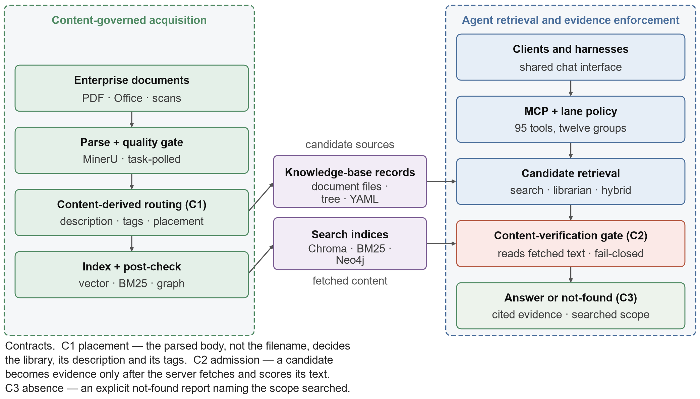
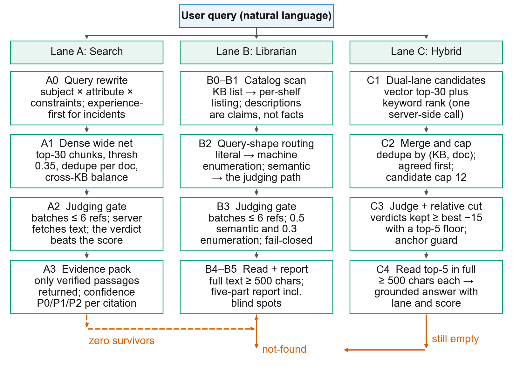
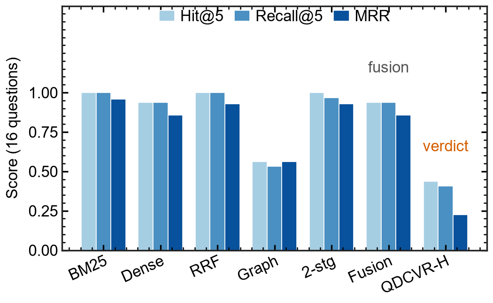
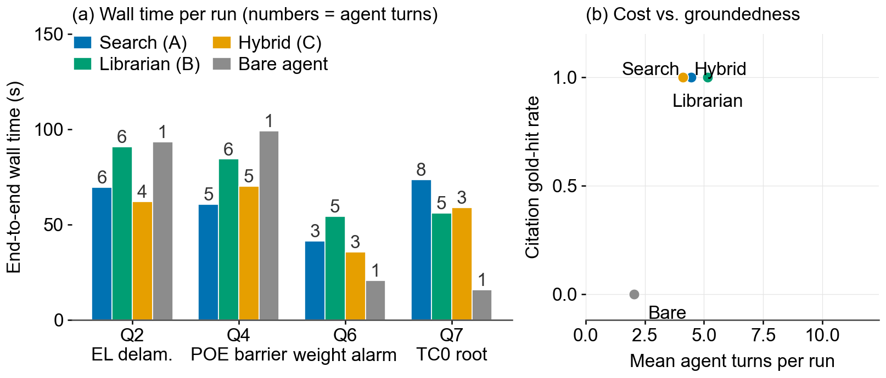
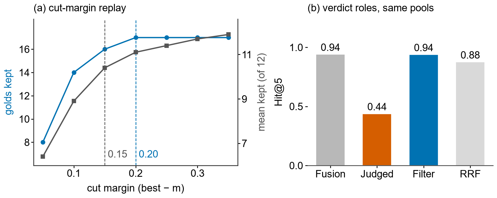
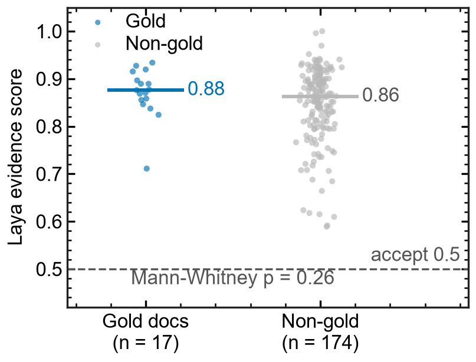
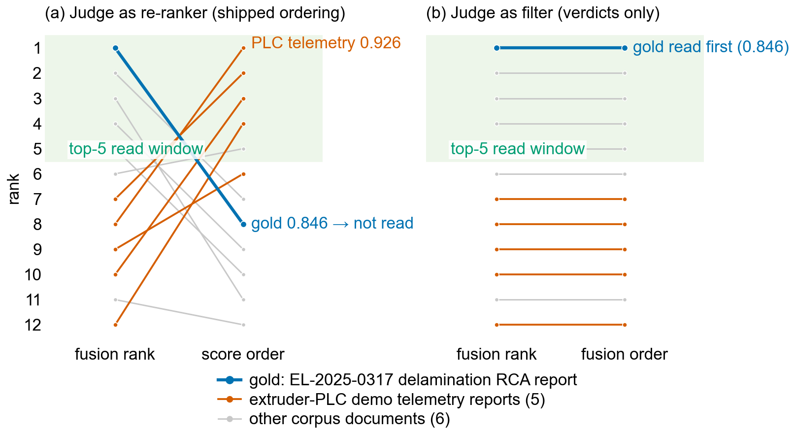
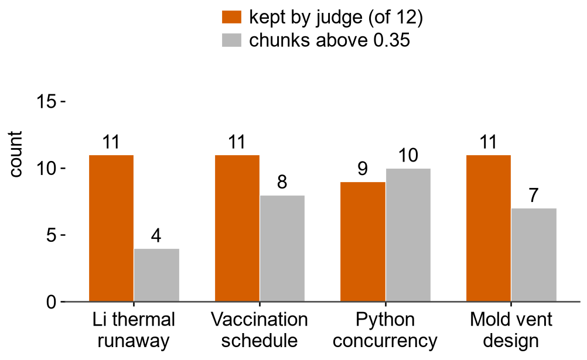
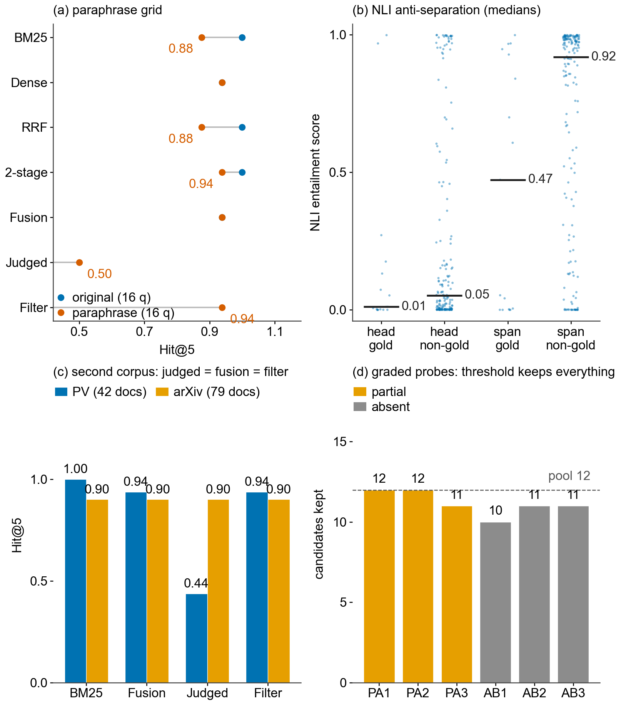

Retrieval-augmented generation ,Agentic retrieval ,Knowledge base management ,Content verification ,Trustworthy question answering , Model Context Protocol

# Introduction

Enterprises accumulate process regulations, failure analyses, and operational lessons as unstructured documents spread across shared drives. Answering a concrete engineering question — *why did edge delamination appear in an EL inspection of a laminated photovoltaic module?* — requires locating the one report among thousands that records the decision, reading it, and citing it. Retrieval-augmented generation (RAG) addresses the location step by embedding documents and the query into a shared vector space \[rag-lewis, dpr\], and modern agentic stacks let a large language model (LLM) orchestrate retrieval tools iteratively \[mcp, singh-agentic-rag\]. Yet the dominant ranking signal — dense cosine similarity — is a measure of *topic relatedness*, not of *evidence presence*. A document that merely discusses similar materials can outrank the one document that contains the answer, and a fluent generator can readily synthesize an answer from the wrong source. The result is the well-documented hallucination and misgrounding behavior of LLM pipelines \[siren\].

This paper argues that a primitive most deployed RAG stacks leave implicit is an *explicit content-verification gate*: before a candidate document is allowed to support an answer, its actual text must be fetched and judged against the query by a model whose only job is to answer “does this text contain direct evidence for this question?” Vectors are fast; only the content can confirm. We built QDCVR (Query-Driven Content-Verified Retrieval), a self-hosted platform that makes this primitive the backbone of a complete knowledge-base system — content-routed organization at ingestion, a 97-tool MCP server as the machine interface \[mcp\], and three retrieval lanes that all terminate at the same verification gate — and, because the primitive is itself a model, subjects it to the same scrutiny as any model (Section <a href="#sec:inflation" data-reference-type="ref" data-reference="sec:inflation">7.3</a>).

The three lanes embody a deliberate latency/recall trade-off. The *Search* lane is a vector fast lane: rewrite the query, retrieve a wide candidate net, and submit citation-only references to the verification gate. The *Librarian* lane is a hierarchical navigator that walks library→document catalogs, routes enumeration-style queries to a machine scanner, judges survivors in small batches, and reads only what survived — all within a hard budget of twelve tool calls. The *Hybrid* lane collapses vector and catalog channels into a single server-side orchestrated call that merges candidates, judges them, applies a relative cut with a top-5 floor, and returns full text for the top documents. All lanes fail closed: zero verified evidence yields an explicit not-found report, never a speculative answer.

We assess the platform with two experiment tiers on a deployed industrial corpus of five knowledge bases spanning photovoltaic materials, module failure analysis, plant O&M, and discrete-manufacturing telemetry (42 documents): a tool-layer comparison of seven retrieval pipelines plus two derived configurations on sixteen gold-annotated questions (plus a sixteen-question paraphrase grid), and 16 end-to-end agentic runs that answer four questions through the platform’s public chat API in four arms (three lanes plus a bare agent without knowledge-base tools), followed by a robustness tier: leave-one-out margin generalization, a second verification signal replayed over the logged candidate pools, and graded abstention probes. The contributions are:

1.  **A verifiable-retrieval architecture** (Sections <a href="#sec:system" data-reference-type="ref" data-reference="sec:system">3</a>–<a href="#sec:lanes" data-reference-type="ref" data-reference="sec:lanes">4</a>): content-verified retrieval as a platform primitive whose measured value lies in auditability, per-citation provenance, and fail-closed semantics — with three interchangeable lanes under enforced budgets and an engine-agnostic harness layer that exposes everything as MCP tools.

2.  **A two-tier empirical analysis** (Sections <a href="#sec:setup" data-reference-type="ref" data-reference="sec:setup">6</a>–<a href="#sec:results" data-reference-type="ref" data-reference="sec:results">7</a>): at the tool layer, BM25 and reciprocal-rank fusion are strong baselines on a curated same-domain corpus, and dense retrieval misses exactly one question (Q16) through a near-duplicate confuser family; the verification gate’s re-ranking *reduces* top-5 hit rate from 0.94 to 0.44 when confusers — near-miss same-domain distractors — dominate the candidate pool. At the agent layer, all knowledge-base-grounded lanes ground their answers in gold documents while end-to-end latency is almost entirely LLM turns (machine retrieval is sub-second).

3.  **A quantified verifier-failure analysis** (Section <a href="#sec:inflation" data-reference-type="ref" data-reference="sec:inflation">7.3</a>): an operational quantification, inside a deployed verified-retrieval pipeline, of LLM-judge miscalibration — whose general causes (score compression, self-preference) are documented in the judging literature \[zheng-llmjudge, panickssery-selfpref\] but whose pipeline-level consequences we decompose and measure: same-domain evidence inflation (non-gold median 0.86 versus gold 0.88; Mann–Whitney `p = 0.26`, i.e. no separation), a verdict role asymmetry (verdicts are safe as a binary filter — Hit@5 restored to 0.94, sign test `p = 0.008` — and unsafe as an ordering), a threshold that never abstains out of corpus, and robustness of both the failure and the repair to question paraphrase and to the choice of verification signal. Mitigations (hierarchical reading, relative cuts with floors, calibration) are scoped to what this decomposition supports.

4.  **Operational lessons from production use** (Section <a href="#sec:discussion" data-reference-type="ref" data-reference="sec:discussion">8</a>): three documented incidents, each with its detection symptom and fix — resident judge workers (batch judging 10–12 s → 1–2 s), vector-index segment corruption surfacing as honest “success with zero results” failures, and GPU memory hygiene between embedding and judging workloads.

A preliminary demo describing the platform’s organization and retrieval layers was accepted as a CIKM 2026 demo \[qdcvr-demo\]. This paper extends it with three components that do not appear in the demo: (i) the multi-lane agentic retrieval methodology with enforced per-lane tool budgets; (ii) the verifier-failure analysis — quantified same-domain inflation, the filter/re-ranker role decomposition, and its configuration-level repair; and (iii) the two-tier empirical evaluation on the deployed corpus with all per-run logs released.

## Research questions and reading guide

The paper is organized as a design-to-evidence arc built around four research questions, each answered by one evidence tier and reported in one place (Table <a href="#tab:ataglance" data-reference-type="ref" data-reference="tab:ataglance">1</a>):

RQ1 (Architecture).  
Can content verification be *enforced* as a platform-wide primitive — that is, can a deployed knowledge-base platform guarantee that no citation enters an answer without its content having been judged, across heterogeneous retrieval strategies and independent agent harnesses?

RQ2 (Ranking trade-off).  
What does the verification gate *cost* and what does it *buy* at the ranking layer — and does the answer depend on the role the verdicts play (a filter, an ordering, or a threshold)?

RQ3 (Verifier generality).  
Is the verifier’s failure mode an artifact of one checkpoint, one domain, one language, or one corpus size, or is it structural?

RQ4 (Operational contract).  
Where does honest abstention actually live, and where does end-to-end latency go?

| RQ | Question | Evidence tier | Headline finding |
|:---|:---|:---|:---|
| RQ1 | Is verification an enforceable platform primitive? | Architecture and lanes (§<a href="#sec:system" data-reference-type="ref" data-reference="sec:system">3</a>–§<a href="#sec:impl" data-reference-type="ref" data-reference="sec:impl">5</a>) | Yes — server-side tool whitelists and fail-closed contracts make it a property of the enforcement layer, not of prompt discipline |
| RQ2 | What does the gate cost and buy? | Tool layer, nine configurations (§<a href="#sec:retrieval" data-reference-type="ref" data-reference="sec:retrieval">7.1</a>–§<a href="#sec:inflation" data-reference-type="ref" data-reference="sec:inflation">7.3</a>) | Costs `<`<!-- -->1 s; as a *re-ranker* it loses Hit@5 (`0.94\!\to\!0.44`), as a *filter* it is neutral (`0.94`; sign test `p=0.008`) — its measured value is per-citation provenance, not ranking quality |
| RQ3 | Is the verifier failure structural? | Second signal, span-NLI, symbolic check, second corpus (§<a href="#sec:inflation" data-reference-type="ref" data-reference="sec:inflation">7.3</a>, §<a href="#sec:robustness" data-reference-type="ref" data-reference="sec:robustness">7.6</a>) | Structural: the loss tracks confuser density, not checkpoint, domain, language, or scale |
| RQ4 | Where do honesty and latency live? | Out-of-corpus and graded probes, turn accounting (§<a href="#sec:abstention" data-reference-type="ref" data-reference="sec:abstention">7.4</a>–§<a href="#sec:composition" data-reference-type="ref" data-reference="sec:composition">7.5</a>) | Honesty lives in the reading–answer layer, never in the threshold; latency is LLM-turn-dominated |

This paper at a glance: each research question, the evidence tier that answers it, and the headline finding.

The remainder of the paper follows the arc. Sections <a href="#sec:system" data-reference-type="ref" data-reference="sec:system">3</a> and <a href="#sec:lanes" data-reference-type="ref" data-reference="sec:lanes">4</a> present the architecture and the three retrieval lanes and answer RQ1 (Section <a href="#sec:trace" data-reference-type="ref" data-reference="sec:trace">3.4</a> first walks one real question end to end so the components are concrete before the measurements begin); Section <a href="#sec:impl" data-reference-type="ref" data-reference="sec:impl">5</a> reports the engineering that makes the contracts enforceable; Sections <a href="#sec:setup" data-reference-type="ref" data-reference="sec:setup">6</a>–<a href="#sec:results" data-reference-type="ref" data-reference="sec:results">7</a> carry the two experiment tiers plus the robustness tier and answer RQ2–RQ4; Section <a href="#sec:discussion" data-reference-type="ref" data-reference="sec:discussion">8</a> distills the operational lessons, threats, and roadmap; Section <a href="#sec:conclusion" data-reference-type="ref" data-reference="sec:conclusion">9</a> concludes. Table <a href="#tab:modules" data-reference-type="ref" data-reference="tab:modules">3</a> in Section <a href="#sec:system" data-reference-type="ref" data-reference="sec:system">3</a> maps every module to its responsibility; Table <a href="#tab:ataglance" data-reference-type="ref" data-reference="tab:ataglance">1</a> maps every research question to its evidence.

# Related work

## Retrieval-augmented generation and ranking

RAG couples a retriever with a generator to ground open-domain QA \[rag-lewis\]; dense retrievers encode queries and passages into a shared space \[dpr\] and multi-lingual, multi-granularity embedders such as BGE-M3 support hybrid dense–sparse signals \[bge-m3\]. Lexical probabilistic ranking remains a strong baseline in many regimes \[bm25\], and reciprocal-rank fusion is a standard parameter-light way to merge ranked lists \[rrf-cormack\]. Surveys systematize the design space as retrieve-then-read pipelines \[gao-ragsurvey\] and as modular, reconfigurable stacks \[modular-rag\]; QDCVR is naturally read as a modular-RAG instantiation whose added module is the verification gate. Our tool-layer evaluation confirms this picture on a curated industrial corpus: BM25 and RRF match or beat dense retrieval at Hit@5, at millisecond latency. QDCVR uses dense, BM25, and graph signals, but treats all of them as *candidate generators* whose output must still pass content verification.

## Structured and graph-based organization

GraphRAG builds entity–relation graphs over corpora for query-focused summarization \[graphrag\], LightRAG distills the idea into a simpler dual-level retrieval \[lightrag\], and RAPTOR recursively abstracts document trees \[raptor\]. QDCVR’s graph layer is intentionally leaner — Document, KnowledgeBase, and Tag nodes with **BelongsTo**, **HasTag**, and weighted **RelatedTo** edges — because its graph serves two engineering purposes (two-stage candidate expansion and cross-library navigation) rather than global summarization. Our measurements show the keyword-limited graph search is the weakest standalone signal on this corpus (Hit@5 0.56), which is why the platform never lets it answer alone. Industrial deployments in adjacent domains — reliability-preserving diagnosis for distributed drive systems \[rrpdg\] and LLM-multi-agent knowledge-graph QA for industrial models \[comaikg\] — share QDCVR’s concern that domain answers be inspectable; QDCVR differs by making the inspection a standalone, fail-closed gate rather than a property of the answering agent.

## Verification, correction, and abstention

Self-RAG trains a generator to critique retrieved evidence and its own output \[selfrag\]; CRAG adds a corrective retriever that re-evaluates and re-queries when retrieval quality is low \[crag\]; FLARE interleaves generation with forward-looking retrieval triggers \[flare\]; Kamath et al. formalize selective prediction under domain shift \[kamath\]; and CyberBOT applies ontology-grounded retrieval for reliability-critical domains \[cyberbot\]. Verifiability measurement in generative search \[liu-verifiability\] and citation-capable generation \[gao-citations\] frame the problem QDCVR attacks: citations that are present but not supportive.

*LLM-as-a-judge.* The verification gate is an LLM judge, and the judging literature documents exactly the failure modes our measurements expose. MT-Bench/Chatbot-Arena established the paradigm and its bias taxonomy \[zheng-llmjudge\]; LLM relevance judges agree imperfectly with human relevance \[sun-urara\]; listwise LLM re-rankers trade quality for instability at scale \[rankgpt\]; evaluator scores exhibit position and verbosity biases \[zheng-llmjudge\], and evaluators favor generations that resemble their own distribution \[panickssery-selfpref\]; and verifiers can be gamed by optimization pressure \[lightman-verify\]. Our contribution is not the discovery that judges miscalibrate — it is the operational quantification of *same-domain inflation* inside a deployed verified-retrieval pipeline and the decomposition of which judge *role* (filter, ordering, or threshold) is safe under which pool conditions.

These approaches verify *during generation* with the generator itself. QDCVR instead externalizes verification into a dedicated judging model that sees only (query, document-text) pairs and is consumed as a tool; any lane, agent, or external system can call it, and its verdicts fail closed. This makes verification an inspectable, reusable platform service rather than an implicit property of one generator’s prompting.

*Abstention.* Beyond selective prediction under domain shift \[kamath\], recent work probes whether LLMs know what they do not know \[yin-knowwhat\] and trains or orchestrates models to abstain on knowledge gaps \[feng-abstain\]. Section <a href="#sec:abstention" data-reference-type="ref" data-reference="sec:abstention">7.4</a> locates QDCVR’s abstention not in any of these calibrated-uncertainty mechanisms but in the pipeline’s reading-and-answer structure — a complementary, architectural answer to the same problem.

## Agentic retrieval and tool protocols

ReAct established interleaved reasoning and acting over tools \[react-yao\]; tool-learning extended it to self-supervised tool use \[toolformer\]; the Model Context Protocol standardizes tool servers as a machine interface \[mcp\]; and recent surveys systematize agentic RAG \[singh-agentic-rag\], listing efficiency among its open challenges. DeepRead shows that structure-aware navigation over long documents improves agentic search \[deepread\], which matches our librarian lane’s document-coordinate reading. QDCVR contributes an agentic-retrieval *policy* layer: per-lane tool whitelists enforced by the server (a librarian-lane agent physically cannot call the vector tool), hard call budgets, and single-call server-side orchestration for the hybrid lane, targeting the turn count that our measurements (Section <a href="#sec:composition" data-reference-type="ref" data-reference="sec:composition">7.5</a>) show dominates agentic latency.

## Positioning

Table <a href="#tab:positioning" data-reference-type="ref" data-reference="tab:positioning">2</a> contrasts QDCVR with representative systems. No prior system combines (i) content-verified citations as a platform-wide gate, (ii) multiple interchangeable lanes with enforced tool budgets, and (iii) fail-closed abstention, inside one self-hosted knowledge-base product with a standard tool protocol. We also report where this design fails (Section <a href="#sec:inflation" data-reference-type="ref" data-reference="sec:inflation">7.3</a>), which closed systems rarely do.

| System | Dense/lex. | Graph | Verified | Abstain | Lanes | KB mgmt |
|:---|:--:|:--:|:--:|:--:|:--:|:--:|
| Vanilla RAG \[rag-lewis\] | ✓ |  |  |  |  |  |
| GraphRAG \[graphrag\] | ✓ | ✓ |  |  |  |  |
| RAPTOR \[raptor\] | ✓ |  |  |  |  |  |
| LLM judge re-ranker \[rankgpt\] | ✓ |  | re-ranker |  |  |  |
| Self-RAG \[selfrag\] | ✓ |  | gen.-internal | partial |  |  |
| CRAG \[crag\] | ✓ |  | corrective |  |  |  |
| DeepRead \[deepread\] | ✓ |  |  |  | agentic |  |
| QDCVR (this work) | ✓ | ✓ | ✓ | ✓ | ✓ | ✓ |

Positioning against representative systems. “Verified” = retrieved content is judged against the query by a dedicated model before it may enter an answer (Self-RAG’s check is performed internally by the generator \[selfrag\]; CRAG re-queries on low retrieval confidence \[crag\]; LLM judge re-rankers score relevance but their ordering is consumed directly \[rankgpt\]). “Abstain” = an explicit not-found is a terminal system state (Self-RAG’s partial abstention is mediated by its critique/reflection tokens; CRAG instead falls back to parametric knowledge or web search). “Lanes” = multiple retrieval strategies behind one interface; “KB mgmt” = ingestion, organization, and library lifecycle management. Presence in the table marks capability, not measured quality.

# Platform architecture

## Design principles

QDCVR (v2.3) is a self-hosted platform that turns a folder of PDFs, Office documents, and scans into knowledge bases that agents can be trusted to answer from. Five principles shape the architecture (Fig. <a href="#fig:arch" data-reference-type="ref" data-reference="fig:arch">1</a>; Table <a href="#tab:modules" data-reference-type="ref" data-reference="tab:modules">3</a> maps every module to its responsibility and the design decision that shapes it):

P1 – Content-routed organization.  
Documents are organized by what they *say*, not by which folder they sat in: ingestion derives tags and a five-field description from the extracted content, and retrieval starts from a library catalog rather than a directory path.

P2 – MCP-first machine interface.  
Every capability is exposed as a tool of a Model Context Protocol server \[mcp\]: 97 tools in eight groups (search, graph, judging, experience, persona management (SOUL), ingestion/parsing, library lifecycle, filesystem/tags). Web, HTTP, CLI, and MCP clients sit on the same layer, so a capability added once is available to every harness.

P3 – Verification before promotion.  
No similarity score, however high, promotes a document into an answer; a judging model must read the candidate’s fetched content and vote. Verdicts fail closed: missing text, engine errors, or timeouts reject the candidate rather than pass it.

P4 – Honest abstention.  
When verification eliminates every candidate, the system returns an explicit not-found report listing what was searched and what was not covered. Refusing to answer is a terminal success state, not an error path.

P5 – Engine-agnostic agency.  
Answer agents are pluggable harnesses (14 adapters, e.g. `omp`, Claude, ACP-compatible CLIs); the platform constrains them through tool whitelists and prompts, never by coupling to a particular vendor.

<figure id="fig:arch" data-latex-placement="t">

<figcaption>QDCVR architecture. The ingestion pipeline (left) parses, splits, describes, and indexes documents into four stores. At run time (right), clients reach answer agents through the chat API; a lane-gating policy constrains each retrieval lane to its toolset; the MCP server exposes 97 tools over FastAPI domain services, which in turn operate the storage engines. All retrieval lanes terminate at the verification gate (the Laya judging service, Section <a href="#sec:gate" data-reference-type="ref" data-reference="sec:gate">4.5</a>).</figcaption>
</figure>

## Ingestion pipeline

Ingestion is a nine-step, quality-gated flow executed by an archival sub-agent through MCP tools: (1) pre-flight tool probing; (2) duplicate detection (exact SHA-256 plus near-duplicate vector search at `≥ 0.90` cosine); (3) a library census; (4) parsing with MinerU \[mineru\] (local OCR engine for scanned PDFs, direct reading for Markdown/text); (5) a semantic split gate for documents beyond 30 000 characters (the agent proposes split boundaries; a validator enforces a 0.85 target utilization and forbids oversized atomic units); (6) content-derived tagging and description; (7) multi-channel indexing (vector + graph + BM25); (8) a post-condition check that the new document is actually retrievable; and (9) an audited report. Two design choices matter in practice. First, descriptions are generated by reading the content, and the retrieval layer treats them as *claims to be verified* rather than truth — in an audit of 26 document descriptions on a predecessor corpus, 24 were found to mismatch their documents’ actual content (released audit logs). Second, indexing success is judged by observable effects (`total_chunks` `> 0`), because we observed GPU out-of-memory failures that returned success envelopes with empty index payloads.

## Storage and service layers

Four stores back the platform. A tree filesystem holds Markdown documents with a metadata registry (library states, document paths, tags); per-library ChromaDB collections index BGE-M3 embeddings \[bge-m3, chroma\] (1024-d, cosine space, 500-char chunks with 50-char overlap); Neo4j \[neo4j\] maintains the Document/KnowledgeBase/Tag graph with weighted **RelatedTo** edges derived from shared tags, vector similarity, and agent judgments; and a jieba-tokenized BM25 inverted index \[bm25\] supports lexical matching. Domain services wrap these stores: the vector service serializes writes per collection (we traced one production incident to concurrent HNSW segment handles), the two-stage service fuses BM25 and graph expansion for candidate generation before a dense refine stage, the experience service versions operational lessons as first-class documents with their own retrieval threshold, and the verification gate is served by a resident judge worker whose engineering details appear in Section <a href="#sec:impl" data-reference-type="ref" data-reference="sec:impl">5</a>.

Table <a href="#tab:modules" data-reference-type="ref" data-reference="tab:modules">3</a> consolidates the platform’s modules, their responsibilities, and the design decision that shapes each one; the remainder of this section walks through the layers, and Sections <a href="#sec:lanes" data-reference-type="ref" data-reference="sec:lanes">4</a>–<a href="#sec:impl" data-reference-type="ref" data-reference="sec:impl">5</a> detail the retrieval lanes and operational engineering built on top of them.

| Module | Responsibility | Key design decision |
|:---|:---|:---|
| Ingestion pipeline | parse, split, tag, index, verify retrievability (nine steps) | quality-gated: a document that cannot be retrieved is a failed ingest, not a warning |
| Tree filesystem + metadata registry | source of truth for Markdown documents, library states, tags | content-routed organization; paths are addresses, not categories |
| Vector service | dense top-`k` over per-library HNSW (BGE-M3, 1024-d) | serialized writes per collection (one production incident traced to concurrent segment handles) |
| Graph service (Neo4j) | Document / KnowledgeBase / Tag graph | **RelatedTo** edges from shared tags, similarity, and judge verdicts; candidate expansion only |
| BM25 index | lexical channel | jieba tokenization, chunked documents, incremental updates |
| Two-stage service | candidate generation | BM25 + graph expansion, then dense refine; adds candidates, never answers |
| Experience service | versioned operational lessons | first-class retrievable documents with their own threshold and auto-summary |
| Laya judge | evidence scoring (0–8 rubric, `[0,1]` projection) | resident worker; batch `≤ 6`; fail-closed on every error |
| MCP server (kb-mcp) | the machine interface: 97 tools in 8 groups | every capability added once is available to every harness |
| Chat API + lane gating | engines, budgets, per-lane tool whitelists | server-side enforcement — a lane physically cannot call a non-whitelisted tool |
| Ingestion tagging agent | content-derived tags and descriptions | descriptions are claims to be verified, not facts |

Module responsibilities. Every module terminates at an explicit contract (a tool schema, a rubric, or a budget) rather than at an implicit prompt.

## How a query flows through QDCVR: one trace

Figure <a href="#fig:arch" data-reference-type="ref" data-reference="fig:arch">1</a> shows the components; this subsection makes them concrete by following one real question end to end. The question is Q2 of Section <a href="#sec:setup" data-reference-type="ref" data-reference="sec:setup">6</a> — *“EL inspection shows edge delamination: root cause and corrective actions”* — asked through the public chat API with the failure-analysis library pinned and the Hybrid lane selected.

1.  **Request and policy.** The chat endpoint inspects the request and attaches the Hybrid lane’s tool whitelist and instructions. Because the whitelist is enforced server-side, the agent physically cannot call a tool outside it — the lane is a property of the enforcement layer, not of prompt discipline.

2.  **One orchestrated call.** The agent issues a single `kb_hybrid_search`. Both candidate channels then run server-side: a dense vector channel (top-30, cosine threshold 0.35) and a catalog keyword channel over the pinned library’s descriptions.

3.  **Merge and cap.** Candidates are merged on (library, document), documents agreed by both channels are ordered first, and the pool is capped at twelve. On Q2 the pool is twelve documents: the gold root-cause report plus eleven same-domain siblings.

4.  **The verification gate.** The server fetches each candidate’s full text itself — the agent never supplies text, so it cannot argue for a document it has not read — segments it, and scores “does this text contain direct evidence that answers the query” in batches of at most six. On Q2 the gold report scores 0.846 while five extruder-telemetry reports score 0.887–0.926.

5.  **Cut and read.** A document-level relative cut (keep `≥ best-0.15`, top-5 floor, cross-domain anchor guard) selects the kept set, and the top five documents are returned in full (≤2 000 characters each). This is the only full-content channel the agent sees.

6.  **Answer with provenance.** The same response carries the complete audit trail (per-channel candidates, merge counts, judge statistics, cut decisions). The agent composes an answer whose citations name the document path, the lane, and the engine score, graded P0 (direct evidence) through P2 (weak).

7.  **Failure and abstention paths.** If the cut leaves no survivor, Lane A escalates once to Lane B; if Lane B also exhausts its twelve-call budget, the system returns an explicit not-found report rather than a speculation (§<a href="#sec:abstention" data-reference-type="ref" data-reference="sec:abstention">7.4</a>).

The trace also shows *where* the design fails. Under the shipped re-ranking role, Q2’s gold (0.846) is pushed to rank eight by the five higher-scoring telemetry reports — outside the five-document read window, so the agent reads confusers (Fig. <a href="#fig:anatomy" data-reference-type="ref" data-reference="fig:anatomy">7</a>). Under the filter role the same pool, the same scores, and the same verdicts leave the gold first. Same gate, same evidence; only the role of the induced ordering changes. This one trace foreshadows the paper’s central result (Section <a href="#sec:inflation" data-reference-type="ref" data-reference="sec:inflation">7.3</a>) and is why it is placed before, not after, the experiments.

# Multi-lane verified retrieval

All answering agents reach the platform through one chat endpoint. The server-side *lane policy* inspects the request (pinned libraries, prompt suffixes, engine) and attaches the corresponding tool whitelist and instructions; a librarian-lane agent, for example, is denied the vector and two-stage tools at the protocol level, so the lane is a property of the enforcement layer, not of prompt discipline. Fig. <a href="#fig:lanes" data-reference-type="ref" data-reference="fig:lanes">2</a> summarizes the three lanes.

<figure id="fig:lanes" data-latex-placement="t">

<figcaption>The three retrieval lanes. Every lane ends at the same content-verification gate and the same honesty contract: zero verified evidence escalates (Lane A→B) or terminates in an explicit not-found report.</figcaption>
</figure>

## Why three lanes — and when to use which

The three lanes are not three implementations of one idea; they occupy three points on a latency/coverage frontier (Table <a href="#tab:lanes" data-reference-type="ref" data-reference="tab:lanes">4</a>). The Hybrid lane is the fastest and the most auditable — it moves orchestration server-side and ships its audit trail in one response — and is the interactive default. The Librarian lane is the one that must not miss a document: it spends its twelve-call budget on catalog navigation and buys exhaustive coverage with explicit blind-spot disclosure. The Search lane sits between them as the latency-tuned interactive path for pinned libraries.

| Lane | Optimises for | Tool budget | Measured (round 1) | Use when |
|:---|:---|:---|:---|:---|
| A. Search | latency on pinned libraries | 20-turn cap | 6–8 turns; 70–165 s | interactive default; single-library questions |
| B. Librarian | exhaustive recall across all libraries | hard 12-call budget | 5–6 turns; 54–91 s | must-not-miss; enumeration questions; no library pinned |
| C. Hybrid | single-call server-side orchestration | exactly 1 call | 3–5 turns; 36–70 s | fastest grounded answer; latency-critical |

The three lanes as operating points. Measured figures are the round-1 agentic runs of Section <a href="#sec:agentic" data-reference-type="ref" data-reference="sec:agentic">7.2</a>. All three share one verification gate and one honesty contract; they differ only in retrieval affordance and budget.

Two honest caveats accompany this table. First, in the measurements of Section <a href="#sec:agentic" data-reference-type="ref" data-reference="sec:agentic">7.2</a> the Search lane does not occupy a *distinct* operating point — the Hybrid lane is faster and the Librarian lane is more exhaustive — so a two-lane deployment (Hybrid plus Librarian) is defensible today, with the Search lane retained as the pinned-library interactive default; query-shape auto-selection is future work (Section <a href="#sec:threats" data-reference-type="ref" data-reference="sec:threats">8.1</a>). Second, and more importantly, the three lanes differ only in retrieval affordance and budget: they share one gate, one fail-closed contract, and one abstention semantics. The trust model is a property of the platform, not of the lane.

## Lane A: Search — vector fast lane with a verification gate

Lane A optimizes for latency on pinned libraries. Phase A0 rewrites the query into (subject, attribute, constraints) form, splits multi-entity and comparison questions into parallel sub-queries, and routes incident-style queries to the experience store (Section <a href="#sec:system" data-reference-type="ref" data-reference="sec:system">3</a>) first. Phase A1 issues one wide dense query (top-30, threshold 0.35, cross-library balancing), deduplicates by document, and *keeps all candidate documents rather than truncating to the top chunks*. Phase A2 submits citation-only references (library id + document path) to the verification gate in batches of at most six; the server fetches the full text itself, so the agent never fabricates content when arguing for a document. A document with vector score 0.95 that the judge rejects is dropped; a document at 0.40 with one *yes* verdict survives. Phase A3 returns the judge’s evidence pack (the only full-content channel in this lane) and the agent composes an answer whose citations carry confidence levels (P0 direct evidence, P1 partial, P2 weak).

## Lane B: Librarian — hierarchical navigation under a budget

Lane B is for exhaustive recall across all libraries and for queries whose vocabulary may not match the corpus. It walks a fixed spine with a hard budget of twelve tool calls: L0 reads the library catalog (ids, names, descriptions, counts) and prunes shelves (libraries) by the rewritten query; L1 lists each surviving shelf’s documents with descriptions; L2 routes by query shape — literal/enumeration questions (“which documents mention X”) go to a machine-side scanner (`≈`<!-- -->0.5 s per document, no LLM turns), semantic questions go to judging; L3 judges in batches of at most six references (larger batches historically triggered transport timeouts and fail-closed batch loss); L4 reads only survivors (bounded to 2 000 characters, starting at the judge-reported evidence line); L5 emits a five-part report (search paths, answer, sources, confidence, blind spots). Two rules are absolute: catalog descriptions never prune documents by themselves, and an exhausted budget terminates in blind-spot disclosure, not in a guessed answer.

## Lane C: Hybrid — server-side orchestration in one call

Agentic latency is dominated by LLM turns, not by tools (Section <a href="#sec:composition" data-reference-type="ref" data-reference="sec:composition">7.5</a>); Lane C spends exactly one call by moving the entire pipeline into the server. A single `kb_hybrid_search` call executes P1 (a parallel block: vector channel, top-30 at threshold 0.35, and catalog keyword channel); P3 merges candidates by (library, document) with agreed-by-both documents first, capped at twelve; P4 judges every candidate with the verification gate in batches of six (criterion *evidence*, threshold 0.5); P4b applies a document-level relative cut — keep scores `≥ best -
0.15` with a top-5 floor, plus a cross-domain anchor guard that prevents an inflated out-of-domain score from setting the cut line; and P5 reads the top five documents in full (≤2 000 characters each). The response carries the complete audit trail (per-lane candidates, merge counts, judge statistics, cut decisions, read contents), so a one-call lane is still an inspectable lane.

## The verification gate

The gate is a locally hosted evidence-classification model (the Laya judging service \[laya\]) invoked through a `kb_laya_judge` tool. Its contract: given the query and a batch of document references, fetch each document server-side, segment it, and score *does this text contain direct evidence that answers the query* under one of three criteria — *evidence* (specific substantiation; mere topic match is insufficient), *instance* (contains at least one member of the requested class; routed automatically for enumeration questions), or *auto*. Scores live in `[0,1]` with an acceptance threshold of 0.5 (0.3 for enumeration). All operating constants in this section — thresholds, the six-reference judge batch, the hybrid candidate cap of twelve, and the 0.15 relative-cut margin with its top-5 floor — are the platform’s shipped production defaults, fixed during earlier deployments on a different corpus, and were not tuned on the evaluation questions of Section <a href="#sec:setup" data-reference-type="ref" data-reference="sec:setup">6</a>. At the protocol layer the platform documents scores as a 0–8 rubric (topic 0–3, scenario 0–3, evidence 0–2; ≥6 answers directly, 5 escalates to the librarian lane, ≤4 drops); the `[0,1]` score is the machine-readable projection of that rubric, and the rubric is the human-auditable contract published to platform clients. The projection can saturate — the logged maximum score is 1.0000 — one more reason thresholds carry no discriminating power between golds and same-domain confusers. The judge model itself is a locally fine-tuned evidence classifier (checkpoint reference released with the platform artifacts); it is deterministic in our replays — repeat calls with identical inputs reproduced identical orderings (Section <a href="#sec:retrieval" data-reference-type="ref" data-reference="sec:retrieval">7.1</a>) — and it is a *single* checkpoint: every verifier finding in this paper inherits that choice, which Section <a href="#sec:threats" data-reference-type="ref" data-reference="sec:threats">8.1</a> treats as an explicit scope limit. Fail-closed semantics apply to every failure mode: fetch errors, engine errors, and timeouts count as rejection. Survivors are aggregated into an evidence pack with per-passage provenance.

## Honest abstention

If a lane ends with zero verified documents, Lane A escalates once to Lane B; if Lane B also exhausts its budget without a survivor, the answer is the not-found report: what was searched (libraries, document counts), what the query was routed as, and which topics sit outside the corpus. Because abstention is a terminal state in the lane contract — enforced by the server-side policy rather than advised in a prompt — it can be evaluated like any other outcome, which Section <a href="#sec:agentic" data-reference-type="ref" data-reference="sec:agentic">7.2</a> does.

# Implementation

This section answers RQ1 in engineering terms: it reports the components and mechanisms that make the contracts of Sections <a href="#sec:system" data-reference-type="ref" data-reference="sec:system">3</a>–<a href="#sec:lanes" data-reference-type="ref" data-reference="sec:lanes">4</a> enforceable in a running deployment rather than aspirational.

The backend is Python 3.12/FastAPI; storage engines are ChromaDB (per-KB HNSW \[hnsw\] collections, cosine space) and Neo4j 5.20; embeddings are BGE-M3 \[bge-m3\] (1024-d, normalized, batch 32, lazy-loaded singleton with an LRU encode cache); parsing uses MinerU \[mineru\] with a local OCR engine; lexical indexing uses jieba tokenization \[jieba\]. The MCP server exposes 97 tools over SSE and stdio transports \[mcp\]; the judging model runs as a resident worker with a machine-level file lock, an LRU verdict cache, and explicit CUDA-cache release between workloads. The worker matters in production: a cold judge load costs 10–12 s per batch, the resident worker 1–2 s; and when judge and bulk-embedding workloads ran interleaved without cache cleanup, one end-to-end run degraded from 68 s to 27 minutes under the Windows WDDM display-page manager (internal profiling; released operations log). The web tier is Nuxt 3 with a chat endpoint that adapts 14 agent harnesses to a uniform message stream; the lane policy whitelists 21 read-only MCP tools per retrieval turn and denies 40+ harness-internal tools (file editors, web search, sub-agents) which, when left enabled in our profiling, added 14–170 s of detour behavior per run (per-run logs in the released artifact). An experience subsystem versions operational lessons as retrievable documents (higher threshold, 0.55) and supports a rules-based rolling summary triggered every fifth ingestion. The full system, including the experiment harness of Section <a href="#sec:setup" data-reference-type="ref" data-reference="sec:setup">6</a>, is open source.[^1]

# Experimental setup

## Corpus and gold questions

The live catalog contains five deployed knowledge bases from an industrial setting spanning photovoltaic materials, module failure analysis, plant O&M, and discrete-manufacturing telemetry: thin-film process regulations (3 documents), a PV-module failure-analysis library (2), a PV-plant O&M library (5), an industrial workshop library with 31 documents including 20 near-duplicate equipment-telemetry reports, and a one-document production watch-clause library — 42 documents in total. The telemetry cluster is a deliberate stressor: its documents share prefixes, domains, and vocabulary, mimicking the confuser density of real deployments. We authored sixteen domain questions (Table <a href="#tab:questions" data-reference-type="ref" data-reference="tab:questions">5</a>), each with one or two gold documents identified by unique filename fragments, and 1–3 fact markers (numbers or terms any grounded answer must contain, e.g. the 61–68% vs. ≥85% cure-degree contrast for the EL question (Q2), and the “TC0” dead-loop verdict for the telemetry question (Q7)). Two corpus-integrity incidents surfaced while setting up the evaluation and were repaired through the platform’s own remediation path before any measurement: one document missing from its vector collection (re-indexed via `index-document`) and one library whose collection had been silently lost (rebuilt via `reindex`); both incidents are instances of the failure class discussed in Section <a href="#sec:discussion" data-reference-type="ref" data-reference="sec:discussion">8</a>.

| \# | Question (abridged, translated) | Gold document(s) | Design intent |
|:---|:---|:---|:---|
| Q1 | EVA encapsulation film lamination: how to set the temperature, pressure and time window; how to control cure degree | EVA process essentials; EVA hydro-thermal aging mechanism | multi-gold |
| Q2 | EL inspection shows edge delamination: root cause and corrective actions | EL-2025-0317 delamination RCA report | incident → RCA |
| Q3 | Why does humid aging of EVA generate acetic acid and corrode ribbons; moisture transport mechanism | EVA hydro-thermal aging mechanism | mechanism |
| Q4 | Moisture-barrier behavior of POE encapsulant; lamination differences vs. EVA | POE process essentials | cross-material |
| Q5 | Summer power drop at a PV plant: systematic troubleshooting order | Power-drop troubleshooting manual; O&M lessons | synonym gap (“drop” vs. “plunge”) |
| Q6 | Trigger condition, nominal value and tolerance of the line-1027 part weight alarm | Watch-clause document (31.35 g ±<!-- -->0.05 g, 5 min) | numeric exactness |
| Q7 | Melt temperature fell 206→<!-- -->180 °C on extruder line 1: final root-cause verdict | TC0 dead-loop RCA revision (among 20 telemetry dups) | confuser density |
| Q8 | PET biaxial stretching process flow and critical temperature ranges | PET process regulation | plain factual |
| Q9 | Frequent inverter alarm trips: handling steps | Inverter alarm handling manual | PV O&M family |
| Q10 | Hot-spot acceptance criteria and disposal | Hot-spot detection and disposal procedure | PV O&M family |
| Q11 | String mismatch causes; IV-curve diagnosis | String mismatch analysis method | PV O&M family |
| Q12 | PP cast-film extrusion parameters; chill-roll temperature | PP cast film process regulation | plain factual |
| Q13 | Weight closed-loop run1: staircase excitation design | Weight optimization staircase record | telemetry cluster |
| Q14 | FT full-function regression after P0 optimization | FT regression test record | telemetry cluster |
| Q15 | Multimodal diagnosis: fusing scalar, vector and image signals | Three-modality closed-loop record | telemetry cluster |
| Q16 | Post-compensation recovery verification of the heatdecay092 event | heatdecay092 compensation verification (among 3 near-dup incident docs) | confuser density |

Gold-annotated question set over the five production knowledge bases. “Gold” lists unique filename fragments of the ground-truth documents. All sixteen questions serve the tool-layer experiment; Q2, Q4, Q6, Q7 also serve the agentic experiment.

## Methods and arms

*Tool layer* (Section <a href="#sec:retrieval" data-reference-type="ref" data-reference="sec:retrieval">7.1</a>): seven methods answer “which documents back this question” with top-5 document lists: BM25 (jieba+Okapi, `k_1{=}1.5`, `b{=}0.75`, built over all 42 full texts), Dense (`kb_search_vector`, BGE-M3, per-document best chunk), RRF (k=60 fusion of the two), Graph (`kb_graph_search` over top jieba keywords, best-rank merge), Two-stage (`kb_search_two-stage`: BM25+graph candidates then dense refine), Fusion-only (the hybrid lane’s merge order without judging), QDCVR-Hybrid (the full single-call lane with judging and relative cut), and two *derived* configurations computed from the hybrid lane’s logged candidate pools and per-candidate judge scores — *judge-as-filter* (verdicts accept or reject; fusion order preserved) and *RRF-fuse* (reciprocal-rank fusion of the fusion and judge orderings) — which isolate whether the retrieval loss comes from the verdicts or from the ordering they induce. (The replay re-issues one QDCVR-Hybrid call per question with an identical configuration and reads the pools and scores from its logged response; the judged orderings reproduce the original runs exactly, indicating deterministic judging. One merge-stage exception: Q14’s replay merge produced twelve candidates against the original run’s eleven judged; all statistics use the original logged pools.) The seven pipeline methods run over the full 42-document catalog with no library pinning; all output document-level rankings (BM25 scores full texts; dense aggregates chunks by max-pooling), so lists are directly comparable. Two construction asymmetries should be kept in mind when reading the lexical results: BM25 is an evaluation-side reimplementation over full texts (the platform’s internal lexical channel uses the same tokenizer with chunked documents), and its full-text granularity plus the questions’ corpus-vocabulary phrasing both favor lexical matching. All platform methods are invoked exactly as an external agent would invoke them: through the MCP tool interface against the live services.

*Agent layer* (Section <a href="#sec:agentic" data-reference-type="ref" data-reference="sec:agentic">7.2</a>): four arms answer four questions (Q2, Q4, Q6, Q7) through the public chat API, non-streaming, 20-turn budget, 15-minute client timeout: *Search* (library pinned, Lane A policy), *Librarian* (all libraries, Lane B policy), *Hybrid* (library pinned + Lane C suffix), and *Bare* (no knowledge-base tools, answer from parametric knowledge only). Note the deliberate scope difference from the tool layer: pinned arms search a single library (as small as two documents), so their confuser pools are a fraction of the full catalog — Section <a href="#sec:agentic" data-reference-type="ref" data-reference="sec:agentic">7.2</a> returns to this. Every arm is driven by the `omp` CLI agent engine[^2] (v18.4.10) wrapping the same LLM (GLM-5.3-Flash,[^3] default thinking level), so arms differ only in retrieval affordance — plus one honesty instruction appended to the bare arm’s prompt, disclosed verbatim in Section <a href="#sec:agentic" data-reference-type="ref" data-reference="sec:agentic">7.2</a>. Zero-turn empty responses and transient gateway timeouts are retried once (a known transport flake): across the campaign the retry fired on two runs, both of which succeeded on re-run; orphaned engine processes are cleaned between runs. The entire grid is run twice (rounds 1 and 2); Section <a href="#sec:agentic" data-reference-type="ref" data-reference="sec:agentic">7.2</a> reports round 1 in its tables and both rounds in the text.

## Abstention and calibration probes

Beyond the gold questions, four out-of-corpus queries probe the honesty contract at the tool layer, two of them also at the agent layer (across all three grounded arms); and because every judged score is logged, the hybrid cut’s relative margin is replayed offline across a sweep of values (Section <a href="#sec:inflation" data-reference-type="ref" data-reference="sec:inflation">7.3</a>).

## Metrics

Tool layer: Hit@5 (any gold document in top-5), Recall@5 (fraction of gold documents in top-5), MRR@5, and per-call latency (mean and median; each method warmed up once, first call discarded; BM25 is timed in-process while platform methods additionally pay MCP transport, a sub-millisecond cost at the reported scale). Agent layer: end-to-end wall time, agent turns returned by the engine, gold-document citation hit — the answer text contains the gold document’s unique filename fragment (automated substring check; gold fragments were chosen to be unambiguous) — and fact-marker hits (automated substring check against 2–3 ground-truth values or terms per question). Fact markers are treated as *corroborating*, not primary, evidence: several markers overlap the question’s own wording, so marker hits alone cannot establish grounding (the citation check is primary; Section <a href="#sec:agentic" data-reference-type="ref" data-reference="sec:agentic">7.2</a> additionally decontaminates marker matching by deleting gold-citing lines). Refusals are detected when a hedging marker appears in the answer’s opening 200 characters; on the six out-of-corpus agent probes this rule agrees with the manual transcript audit on five and misses one explicit not-found report, so refusal counts reported here are the manually audited ones. All checks are automated string matches against the released transcripts; no human rater was involved. For the verifier analysis we log per-candidate judge scores from the hybrid response. Hardware: one RTX 5060 (8 GB) serves embeddings and the judge worker; all services run locally on Windows. Per-question best ranks for all nine retrieval configurations are tabulated in <a href="#app:perq" data-reference-type="ref" data-reference="app:perq">10</a>.

# Results

This section answers RQ2–RQ4 in order: the ranking trade-off of the gate (§<a href="#sec:retrieval" data-reference-type="ref" data-reference="sec:retrieval">7.1</a>–§<a href="#sec:inflation" data-reference-type="ref" data-reference="sec:inflation">7.3</a>), the deployed lanes and the honesty contract (§<a href="#sec:agentic" data-reference-type="ref" data-reference="sec:agentic">7.2</a>, §<a href="#sec:abstention" data-reference-type="ref" data-reference="sec:abstention">7.4</a>), the latency accounting (§<a href="#sec:composition" data-reference-type="ref" data-reference="sec:composition">7.5</a>), and the robustness tier that tests whether the findings are structural (§<a href="#sec:robustness" data-reference-type="ref" data-reference="sec:robustness">7.6</a>).

## Tool layer: strong baselines and the cost of verification (RQ2)

<table>
<caption>Tool-layer retrieval on the 42-document deployed industrial corpus (mean over 16 gold-annotated questions; top-5 document lists; latency per call, warmed).</caption>
<thead>
<tr>
<th style="text-align: left;">Method</th>
<th style="text-align: center;">Hit@5</th>
<th style="text-align: center;">Recall@5</th>
<th style="text-align: center;">MRR@5</th>
<th style="text-align: center;">Latency (mean)</th>
<th style="text-align: center;">Latency (median)</th>
</tr>
</thead>
<tbody>
<tr>
<td style="text-align: left;">BM25</td>
<td style="text-align: center;">1.00</td>
<td style="text-align: center;">1.00</td>
<td style="text-align: center;">0.958</td>
<td style="text-align: center;">0.9 ms</td>
<td style="text-align: center;">1 ms</td>
</tr>
<tr>
<td style="text-align: left;">Dense (BGE-M3)</td>
<td style="text-align: center;">0.94</td>
<td style="text-align: center;">0.94</td>
<td style="text-align: center;">0.856</td>
<td style="text-align: center;">18 ms</td>
<td style="text-align: center;">17 ms</td>
</tr>
<tr>
<td style="text-align: left;">RRF (BM25‖Dense)</td>
<td style="text-align: center;">1.00</td>
<td style="text-align: center;">1.00</td>
<td style="text-align: center;">0.927</td>
<td style="text-align: center;">11 ms</td>
<td style="text-align: center;">9 ms</td>
</tr>
<tr>
<td style="text-align: left;">Graph (Neo4j)</td>
<td style="text-align: center;">0.56</td>
<td style="text-align: center;">0.53</td>
<td style="text-align: center;">0.562</td>
<td style="text-align: center;">68 ms</td>
<td style="text-align: center;">68 ms</td>
</tr>
<tr>
<td style="text-align: left;">Two-stage</td>
<td style="text-align: center;">1.00</td>
<td style="text-align: center;">0.97</td>
<td style="text-align: center;">0.927</td>
<td style="text-align: center;">77 ms</td>
<td style="text-align: center;">40 ms</td>
</tr>
<tr>
<td style="text-align: left;">Fusion-only</td>
<td style="text-align: center;">0.94</td>
<td style="text-align: center;">0.94</td>
<td style="text-align: center;">0.856</td>
<td style="text-align: center;">62 ms</td>
<td style="text-align: center;">66 ms</td>
</tr>
<tr>
<td style="text-align: left;">QDCVR-Hybrid</td>
<td style="text-align: center;">0.44</td>
<td style="text-align: center;">0.41</td>
<td style="text-align: center;">0.226</td>
<td style="text-align: center;">542 ms</td>
<td style="text-align: center;">582 ms</td>
</tr>
<tr>
<td colspan="6" style="text-align: left;"><em>Derived (offline, same logged hybrid pools):</em></td>
</tr>
<tr>
<td style="text-align: left;">Judge-as-filter†**</td>
<td style="text-align: center;">0.94</td>
<td style="text-align: center;">0.94</td>
<td style="text-align: center;">0.856</td>
<td colspan="2" style="text-align: left;">†**542 ms / 582 ms</td>
</tr>
<tr>
<td style="text-align: left;">RRF-fuse</td>
<td style="text-align: center;">0.88</td>
<td style="text-align: center;">0.88</td>
<td style="text-align: center;">0.606</td>
<td colspan="2" style="text-align: left;">(same single call)</td>
</tr>
</tbody>
</table>

`^{\dagger}` Derived rows replay the QDCVR-Hybrid run’s own logged 12-candidate pools and judge scores, so they reuse that call’s latency; the judge executes once either way. Per-question ranks for all nine configurations: <a href="#app:perq" data-reference-type="ref" data-reference="app:perq">10</a>.

<figure id="fig:retrieval" data-latex-placement="t">

<figcaption>Tool-layer comparison. (a) BM25 and RRF solve this curated corpus almost perfectly; the judged hybrid loses top-5 hits relative to its own fusion stage. (b) All machine retrieval is sub-second; the judged hybrid adds ≈0.5 s over fusion-only for a 12-candidate verification.</figcaption>
</figure>

Table <a href="#tab:retrieval" data-reference-type="ref" data-reference="tab:retrieval">6</a> and Fig. <a href="#fig:retrieval" data-reference-type="ref" data-reference="fig:retrieval">3</a> give the tool-layer results. With sixteen questions the Wilson 95% intervals on the headline Hit@5 proportions are wide (judged hybrid `[0.23, 0.67]`; judge-as-filter `[0.72, 0.99]`; BM25/RRF `[0.81, 1.00]`) — the qualitative decomposition, not the point estimates, is the claim. Three observations matter for practitioners.

**Curated same-domain corpora favor lexical precision.** With 42 well-described documents and questions authored in the corpus’s vocabulary, BM25 achieves Hit@5 1.00 (MRR 0.958) at millisecond latency, RRF matches it (MRR 0.927), and two-stage fusion joins them at Hit@5 1.00 once the corpus is healthy. Dense retrieval misses exactly one question (Q16): the query asks about the *heatdecay092 post-compensation verification* while four near-duplicate sibling reports from the same incident family crowd the top-5 — a confuser-density failure, not a vocabulary one (the earlier 8-question round additionally exposed a synonym miss, Q5’s *drop* vs. *plunge*, which fusion repairs). Graph search, limited to **contains** matching on node names and tags, is the weakest standalone signal (0.56).

**Verification is cheap; re-ranking is the risk.** Judging twelve candidates adds well under a second with the resident worker. But the QDCVR-Hybrid arm loses top-5 hits relative to its own fusion stage (0.44 vs. 0.94 Hit@5). The failure decomposes cleanly: on eight questions (Q2, Q4, Q5, Q6, Q8, Q9, Q11, Q12) the gold document *was* judged and the gate’s verdicts reordered same-domain confusers above it; on Q16 the gold never reached the judge at all — all twelve candidate slots were taken by confusers upstream in the fusion stage. Keeping the verdicts but discarding the induced ordering — the *judge-as-filter* rows of Table <a href="#tab:retrieval" data-reference-type="ref" data-reference="tab:retrieval">6</a> — repairs every one of the eight losses and regresses none (8 wins, 0 losses, 8 ties on Hit@5; exact binomial `p = 0.008`, two-sided), restoring Hit@5 to 0.94 and MRR to 0.856 with every returned citation still judge-verified; the only ranking regression anywhere is Q7, where the gold slips from third to fifth. Said plainly: judge-as-filter returns *exactly the fusion-only ranking* — the per-question orderings are identical on all sixteen questions — so at the tool layer the gate’s measured contribution is the audit metadata attached to each citation, bought at the hybrid call’s `≈`<!-- -->480 ms surcharge over fusion-only. We therefore recommend deployments consume verdicts as a filter rather than an ordering; the change is a single configuration value, and migrating the shipped default is tracked in the roadmap (Section <a href="#sec:conclusion" data-reference-type="ref" data-reference="sec:conclusion">9</a>). Both halves trace to the same root cause, quantified next.

**Two-stage fusion recovers its inputs here.** On the healthy corpus the BM25+graph-then-dense pipeline reaches Hit@5 1.00 (Recall@5 0.97, one gold of a two-gold question ranked outside the top-5), confirming that its added stages neither add nor subtract on this corpus once the stores are intact; per-question results are in the released logs.

## Agent layer: three lanes, one honesty contract (RQ4)

| Arm           | Q   | Wall (s) | Turns | Cite | Facts |
|:--------------|:----|:--------:|:-----:|:----:|:-----:|
| Search (A)    | Q2  |    70    |   6   |  ✓   |  3/3  |
| Search (A)    | Q4  |    61    |   5   |  ✓   |  2/2  |
| Search (A)    | Q6  |    41    |   3   |  ✓   |  3/3  |
| Search (A)    | Q7  |    74    |   8   |  ✓   |  2/2  |
| Librarian (B) | Q2  |    91    |   6   |  ✓   |  3/3  |
| Librarian (B) | Q4  |    84    |   6   |  ✓   |  2/2  |
| Librarian (B) | Q6  |    54    |   5   |  ✓   |  3/3  |
| Librarian (B) | Q7  |    56    |   5   |  ✓   |  2/2  |
| Hybrid (C)    | Q2  |    62    |   4   |  ✓   |  3/3  |
| Hybrid (C)    | Q4  |    70    |   5   |  ✓   |  2/2  |
| Hybrid (C)    | Q6  |    36    |   3   |  ✓   |  3/3  |
| Hybrid (C)    | Q7  |    59    |   3   |  ✓   |  2/2  |
| Bare (no KB)  | Q2  |    93    |   1   |  –   |  2/3  |
| Bare (no KB)  | Q4  |    99    |   1   |  –   |  2/2  |
| Bare (no KB)  | Q6  |    21    |   1   |  –   |  1/3  |
| Bare (no KB)  | Q7  |    16    |   1   |  –   |  0/2  |

Agentic end-to-end runs, round 1: four questions × four arms through the public chat API (engine `omp` over GLM-5.3-Flash, 20-turn budget; the full grid is run twice, see text). “Cite” = the answer names the gold document; “Facts” = ground-truth fact markers contained / available. The bare arm’s sporadic marker matches are coincidental: it cites no source, and its answers typically disclaim figures as unverified parametric recall.

Table <a href="#tab:agentic" data-reference-type="ref" data-reference="tab:agentic">7</a> and Fig. <a href="#fig:e2e" data-reference-type="ref" data-reference="fig:e2e">4</a> summarize the round-1 runs. We present them as an end-to-end case study of the deployed system rather than a statistical comparison; full per-run JSON transcripts are released.

**Grounding is a property of the lanes, not of the model.** All three knowledge-base-grounded arms named the gold document in all twelve valid runs and reproduced all twelve available fact-marker sets — including the exact watch-clause numbers (31.35 g, ±<!-- -->0.05 g, 5 min) and the telemetry root cause (a dead thermocouple loop, “TC0”). The marker hits survive decontamination: after deleting every answer line that names a gold document (so markers must come from the answer’s own prose or tables), all twelve grounded runs still reproduce their full marker sets. Six of the twelve runs answer from pinned libraries of only one or two documents (Q2’s failure-analysis library holds two; Q6’s watch-clause library one), where hitting the gold is a low bar; the substantive evidence is the six runs over Q4 and Q7’s 31-document process library. The bare arm’s prompt adds one instruction — “answer using only your own knowledge; if you are uncertain, say so explicitly” — mirroring a deployment without retrieval; grounded arms receive no honesty instruction beyond their lane prompts. Even so, the bare arm never cited a source: on the EL question it produced a plausible *textbook* diagnosis (interfacial adhesion failure, moisture ingress) that misses the corpus’s recorded root cause — lamination-machine thermocouple drift leaving EVA under-cured, the mechanism Q2’s fact markers encode — and on the telemetry question it hit none of the fact markers (it did refuse explicitly in two of four runs, honest about its ignorance but holding no corpus facts either way). This is the honesty contract of Section <a href="#sec:lanes" data-reference-type="ref" data-reference="sec:lanes">4</a> observed end to end: without verification-grounded retrieval, the same engine produces fluent, unsourced, and in these cases partly wrong answers.

**Reconciling the tool layer and the agent layer.** At the tool layer, the judged hybrid missed nine of sixteen questions; here the hybrid arm hit the gold on all four. Two design differences explain this, and both are part of the lane contract rather than luck. First, pinned scope: the agent arm searches one library (Q2’s failure-analysis library holds two documents), so the same-domain confusers that flood the 42-document tool-layer catalog never enter its candidate pool. Second, agency: a lane that can read what it retrieved and issue follow-up calls is not bound by a single ranking — the librarian lane in particular is built to keep looking. The tool layer measures the ranking stage in isolation; the agent layer measures the lane as deployed. The reconciliation yields an explicit, testable model of what the gate buys. (i) Verdicts as a binary *filter* are safe exactly when judge recall on gold documents is high (here 17/17 in-pool), and they add per-citation audit; discrimination is irrelevant. (ii) Verdicts as an *ordering* are safe only when pairwise gold-versus-confuser score separation exceeds the base ranker’s, which same-domain inflation destroys. (iii) *Threshold abstention* requires out-of-corpus calibration the acceptance threshold does not have. Verification, in this deployment, buys auditability and honest termination — not ranked-list quality (the filter is order-preserving; the re-ranker actively harms it) and not pool composition.

**Partial honesty counts.** The one refusal-flagged grounded run, hybrid-Q4, is a positive case rather than a failure: its answer cites the POE gold document correctly and states explicitly that the library holds no EVA-side comparison data — a scoped, honest disclosure instead of speculation. No grounded run fabricated a citation.

**The lanes buy their latency profiles with turn structure.** Hybrid completed every round-1 question in 3–5 turns (mean 3.8) and 36–70 s; librarian spent 5–6 turns (mean 5.5) and 54–91 s; search sat between on wall time but needed 8 turns on the hardest question (Q7, the telemetry cluster). The librarian’s extra turns buy exhaustive coverage with blind-spot disclosure — the arm that must not miss a document, not the arm that must be fast.

**Repetition: outcomes reproduce, latency does not.** The full grid was run a second time. Citation outcomes agree on all 16 of 16 cells — trivially for the four bare cells (no citations in either round), so the informative agreement is 12/12 grounded cells; the decontaminated fact-marker check is a clean sweep in round 1 (12/12) and near-clean in round 2 (11/12; the exception is hybrid-Q2, whose 61/85 values appear only inside evidence lines that also cite the gold document — an artifact of the line-deletion rule rather than a grounding failure; its citation hit stands). Decontamination is applied to the answer’s first 600 characters, where every matched marker occurs, so the check is conservative. Round-2 turn means track the load (hybrid 5.0, search 7.25, librarian 7.75) while every citation outcome repeats. Wall time and turn counts fluctuate substantially (e.g. search-Q2: 70 s/6 turns in round 1 versus 165 s/11 turns in round 2; librarian-Q4: 84 s/6 turns versus 92 s/11 turns; hybrid-Q2: 62 s/4 turns versus 60 s/3 turns). The dichotomy — stable grounding under unstable latency — is exactly what the turn-economics model of Section <a href="#sec:composition" data-reference-type="ref" data-reference="sec:composition">7.5</a> predicts, and it is the strongest argument for the platform’s fixed turn budgets.

**The fast lane has a real tail.** In the first campaign pass, the search arm (Q2) and the bare arm (Q4) hit the server’s 600 s turn budget and returned gateway timeouts; both re-runs completed normally (70 s and 99 s). We attribute the stalls to engine-side transport stalls under LLM provider load, not to the retrieval layer (whose machine-side latency is sub-second); the platform’s retry-once policy (Section <a href="#sec:setup" data-reference-type="ref" data-reference="sec:setup">6</a>) fired on exactly these two runs. Interactive deployments should treat the server turn budget as the operative tail-latency knob.

<figure id="fig:e2e" data-latex-placement="t">

<figcaption>Agentic runs. (a) Wall time per run; printed numbers are agent turns. (b) Citation gold-hit rate vs. mean agent turns (horizontal offsets added for readability): the hybrid lane reaches fully grounded answers with the fewest turns, the librarian lane spends the most turns for exhaustive recall, and the bare agent cannot ground citations at all.</figcaption>
</figure>

<figure id="fig:marginvariants" data-latex-placement="t">

<figcaption>Attributing and repairing the verification loss. (a) Offline replay of the relative cut: the shipped 0.15 margin loses one gold; 0.20 retains all 17. (b) The same QDCVR-Hybrid pipeline with three roles for the verdicts: as a re-ranking signal the gate costs 0.50 Hit@5; as a filter (fusion order preserved) retrieval returns to the fusion stage’s 0.94 with every citation still judge-verified; score-level fusion with the noisy ordering (RRF) recovers only 0.88.</figcaption>
</figure>

## The verifier’s own failure mode: same-domain inflation (RQ2, RQ3)

<figure id="fig:inflation" data-latex-placement="t">

<figcaption>Evidence-criterion judge scores from the sixteen QDCVR-Hybrid tool runs: all 191 judged candidates. Gold documents (green, <em>n</em> = 17**; Q16’s gold never entered its candidate pool) and same-domain non-gold survivors (orange, <em>n</em> = 174**) overlap almost completely: medians 0.876 versus 0.863, Mann–Whitney <em>p</em> = 0.26**. The 0.5 acceptance threshold separates both groups from zero, not from each other.</figcaption>
</figure>

Fig. <a href="#fig:inflation" data-reference-type="ref" data-reference="fig:inflation">6</a> plots every judge score from the sixteen hybrid runs: 191 candidates (twelve per run except Q14, whose merge produced eleven). Not one candidate was rejected — every logged score is `≥ 0.589`, far above the 0.5 acceptance threshold, so at the threshold layer the gate’s filtering power on this corpus is zero. The failures concentrate in ranking, not acceptance. Aggregating the 17 in-pool gold instances (Q1 and Q5 carry two golds each; Q16’s gold was never judged): only 5 of 17 rank in the top-3 of the judged ordering, while 9 rank eighth or lower. Gold and non-gold score distributions are statistically indistinguishable at this sample size (medians 0.876 vs. 0.863; two-sided Mann–Whitney with tie correction, `U = 1726`, `p = 0.26`, a gold-favoring trend with Cliff’s `δ ≈ 0.17`; scores are nested within 16 runs, so we treat the test as indicative only — and the sign test of Section <a href="#sec:retrieval" data-reference-type="ref" data-reference="sec:retrieval">7.1</a> is likewise post-hoc and descriptive, one of nine configurations evaluated on the same sixteen questions). On Q6 (the 31.35 g±<!-- -->0.05 g watch clause), the fusion ranking placed the gold clause document first, but the judged re-ranking promoted five unrelated telemetry reports (0.92–0.93) while the gold document scored 0.82 — pushing the gold document out of the top-5 that the answer agent reads in full; the same pattern recurs on Q2 (Fig. <a href="#fig:anatomy" data-reference-type="ref" data-reference="fig:anatomy">7</a>), where five extruder-telemetry reports and an unrelated PET process document (0.887–0.926) outrank the gold EL report (0.846). Even the relative cut participates in the failure: it bound in most rounds (trimming one to five tail candidates), and on Q11 its best-minus-0.15 line fell *above* the gold’s score (0.741 vs. 0.711), deleting the gold from the kept set outright.

**An offline replay turns this failure into a calibration result.** Because every judged score is logged, the cut margin can be replayed without re-running the pipeline. Sweeping the margin from 0.05 to 0.35 (with the top-5 floor unchanged): at 0.05 the kept set shrinks to a mean 6.4 candidates but retains only 8/17 golds; the shipped 0.15 margin keeps a mean of 10.4 candidates and 16/17 golds; at 0.20 all 17 golds survive with 11.1 candidates retained. Because the replay selects and evaluates the margin on the same sixteen questions that motivated it, 0.20 is an in-sample observation, not a validated setting; deployment-time calibration must re-derive it per library on fresh questions. The margin is therefore repairable by a small configuration change, but no margin separates golds from confusers, because the scores themselves overlap.

**Cross-domain claims do not survive measurement either.** The design intent — that reading content separates topical neighbors from evidence — does deliver cross-domain filtering *in the answer layer* (Section <a href="#sec:abstention" data-reference-type="ref" data-reference="sec:abstention">7.4</a>), but the acceptance threshold carries none of it. On four out-of-corpus probe queries (lithium-battery thermal runaway, child vaccination schedules, Python concurrency, injection-mold vent design), dense retrieval still returns same-corpus documents at 0.40–0.60 cosine, and the judged hybrid keeps 9–11 of its 12 candidates — the same inflation, now cross-domain. (One early production incident in which an out-of-domain document scored 0.92 on a PV question motivated the anchor guard; the probes show such inflation is the norm, not the exception.) What the probes establish is where honesty actually lives: not in the threshold, but in the reading-and-answer layer that the lanes wrap around it.

This failure is the mirror image of the one the gate was built to stop: dense similarity over-trusts topical neighbors, and the judge — a model used for evidence discrimination — over-trusts domain-internal discourse. The lane design contains two partial mitigations, and their limits are exactly what this analysis exposes. Lane B’s mandatory reading of survivors surfaces mismatched content to the answering agent; and the hybrid cut’s relative margin with a top-5 floor keeps most outranked gold documents in the machine-readable audit trail — though, as Q11 shows, it can also delete one. The quantified repair is cut-margin calibration per library (the replay above); the open problem is the score overlap itself: domain-aware negative training, score normalization against a per-library null distribution, or pairing the judge with a contradiction check. We report this as a measured open problem rather than a solved one.

<figure id="fig:anatomy" data-latex-placement="t">

<figcaption>Anatomy of one real query (Q2; single logged QDCVR-Hybrid call). Each line is one of the 12 fused candidates; the green band is the top-5 window the answer agent reads in full. (a) The shipped re-ranking: the judge scores five extruder-PLC telemetry reports 0.887**–0.926** and the gold root-cause report 0.846**, demoting it from fusion rank 1 to rank 8 — outside the read window. (b) The same call with the verdicts used only as a filter: all 12 pass, the fusion order stands, and the gold is the first document read. Same pool, same scores, same verdicts; only the role of the induced ordering differs.</figcaption>
</figure>

<figure id="fig:ood" data-latex-placement="t">

<figcaption>Out-of-corpus probes at the tool layer: for every probe the judged hybrid keeps 9–11 of its 12 candidates and dense retrieval passes chunks above the 0.35 threshold—the threshold alone never abstains. At the agent layer, all six probe runs returned explicit not-found reports with zero fabricated citations.</figcaption>
</figure>

## Honest abstention under out-of-corpus probes (RQ4)

The lanes’ final contract — an explicit not-found instead of speculation — was never exercised by the gold questions, all of which are in-corpus. Four out-of-corpus probe queries (lithium-battery thermal runaway, child vaccination schedules, Python concurrency, injection-mold vent design) close that gap at both layers (Fig. <a href="#fig:ood" data-reference-type="ref" data-reference="fig:ood">8</a>). At the tool layer, abstention does *not* happen: as Section <a href="#sec:inflation" data-reference-type="ref" data-reference="sec:inflation">7.3</a> showed, the acceptance threshold keeps 9–11 of 12 candidates even for vaccination or battery queries. At the agent layer, the contract holds without exception: all six runs (three grounded arms × two probes) answered with an explicit not-found report — each enumerates the libraries searched, states that the corpus does not cover the topic, and declines to answer from memory; none cites a document as evidence (zero `.md` citations across all six transcripts). Three runs add a dedicated blind-spot section, two disclosing search coverage limits: one librarian run reports that its vector and experience channels were unavailable that round, completed only a catalog-level scan, and therefore “cannot claim exhaustive coverage,” and several runs recommend ingestible sources (e.g. the relevant national standards) instead of fabricating a procedure. The honesty contract is thus real but its enforcement point is the reading-and-answer layer — precisely why the platform wraps verification inside lanes that must read before they answer, rather than exposing a bare similarity threshold.

## Where the time goes: LLM turns, not retrieval (RQ4)

Across the agentic runs, machine-side retrieval is uniformly sub-second (Table <a href="#tab:retrieval" data-reference-type="ref" data-reference="tab:retrieval">6</a>) while the twelve grounded end-to-end runs take 36–91 s: wall time is dominated by LLM turns, at 11.7–15.3 s per turn across arms (per-arm means: search 11.7, librarian 12.8, hybrid 15.3; computed over the twelve grounded runs), consistent with the observation that agentic-RAG latency is turn-dominated \[singh-agentic-rag\]. The lanes differ almost entirely in turn structure: Lane C compresses its pipeline into one tool call; Lane B spends turns on catalog navigation but buys exhaustive coverage and readable provenance; Lane A sits between. The practical consequence is an engineering rule the platform now follows everywhere: *move orchestration server-side and cap turns* — the single-call hybrid lane is both the fastest and the most auditable, because its audit trail ships with the one response.

## Robustness checks (RQ3, RQ4)

Six robustness questions, answered by five released experiments (the symbolic check ships inside the second-signal replay), are summarized in Table <a href="#tab:robustness" data-reference-type="ref" data-reference="tab:robustness">8</a> and Figure <a href="#fig:robustness" data-reference-type="ref" data-reference="fig:robustness">9</a>.

<figure id="fig:robustness" data-latex-placement="!htbp">

<figcaption>The robustness tier at a glance. (a) Paraphrase grid: per-method Hit@5 on the original questions (blue) and their paraphrases (orange); BM25’s ceiling is vocabulary-dependent while dense, fusion, and the filter repair hold. (b) NLI separation over the 191 logged candidates (span scores from 3,**489 span inferences): both granularities <em>anti-separate</em> — gold medians sit below non-gold medians. (c) Domain, language, and scale shift to 79 ingested arXiv papers: the judged collapse disappears when no same-family confuser clusters exist. (d) Graded abstention probes: the threshold keeps 10–12 of 12 candidates in every tier.</figcaption>
</figure>

| Check | Question | Result |
|:---|:---|:---|
| Cut-margin LOO | Is the 0.20 margin an artifact of selecting on all 16 questions? | The smallest-margin rule chosen on 15 questions transfers to 15/16 holdouts (miss = Q11, which the shipped 0.15 also loses); the deployed 0.20 retains all 16 holdout golds. The `+0.02` pad is engineering judgment, not an LOO value. |
| Paraphrase grid (`n{=}16`) | Does the tool layer depend on the questions’ vocabulary? | BM25 1.00→<!-- -->0.88 (MRR 0.958→<!-- -->0.755); dense 0.94; judged 0.50; filter = fusion 0.94. Pooled over 32 variants: 15 wins, 0 losses, 17 ties (`p < 0.0001`). Failure and repair are wording-robust. |
| Second signal (NLI) | Is inflation specific to the Laya checkpoint? | A generic Chinese NLI ranks *worse* (Hit@5 0.31, MRR 0.138; `\rho = -0.13`) and *anti-separates* (gold median 0.011 *below* non-gold 0.053, `p = 0.12`); out-of-corpus topics still score corpus documents up to 0.997. Naive span-max NLI is worse still (0.19; anti-separation `p = 0.007`); the rank-fusion ensemble recovers nothing (0.31). |
| Symbolic check (Q6) | Can rule checks cover what model judges miss? | The watch value “31.35” appears in the gold (1/1) and in no confuser (0/11): the numeric case the judge mishandled is solved by a trivial substring rule. |
| Graded probes (`n{=}6`) | Does the threshold behave differently between partial and absent coverage? | No: the threshold keeps 10–12 of 12 candidates (up to 0.983) in every tier. Agent layer: scoped disclosures on partial probes (one reclassified as covered — the corpus held a verified rework case); 3/3 absent probes returned explicit not-found. |
| Second corpus (100 arXiv papers) | Does the judged collapse survive a domain, language, and scale shift with no confuser clusters? | No collapse at 79 indexed papers (8,031 chunks): judged = fusion = filter = 0.90 (one shared miss — that gold paper failed parsing). The loss tracks confuser density, not domain, language, or size; graph 0.20 without relation tagging (bulk import bypasses it). |

Robustness checks: the question each probe was designed to answer and the measured result. All numbers come from released logs (Section <a href="#sec:robustness" data-reference-type="ref" data-reference="sec:robustness">7.6</a>).

**Margin.** The leave-one-question-out replay (Fig. <a href="#fig:robustness" data-reference-type="ref" data-reference="fig:robustness">9</a>a) (`exp6_loo_margin.py`) addresses the in-sample concern directly: selection and evaluation are separated, the selected margins are stable (0.18 on fifteen of sixteen folds), and the single holdout failure is the already-known Q11 boundary. The deployed default adds a small engineering safety pad on top of the LOO-selected value; the pad’s magnitude is a judgment call, and the Q11 fold is the warning that justifies it — a calibration made without a Q11-like question in its training set would pick 0.15 and lose that gold.

**Paraphrase.** The paraphrase grid (Fig. <a href="#fig:robustness" data-reference-type="ref" data-reference="fig:robustness">9</a>a; `exp6_paraphrase.py`) confirms the vocabulary-dependence concern about BM25’s ceiling — its 1.00 is partly a vocabulary artifact, dropping to 0.88 with MRR 0.755 under rewording — and sharpens the practical picture: dense retrieval is the paraphrase-robust backbone (0.94 unchanged), and both the judged hybrid’s failure (0.50) and the filter repair (0.94, again identical to fusion-only) survive rewording. Pooled over all 32 question variants the filter-versus-judged record is 15 wins, 0 losses, 17 ties (exact binomial `p < 0.0001`). Two honesty notes: the paraphrases are author-written, and one of them (Q7) strips every discriminative token — all nine configurations miss it, so that cell measures a rewording no retriever could follow rather than lexical fragility; and dense’s unchanged rate hides a composition swap (it loses reworded Q7 and gains Q16). The verification failure is a property of the judge and the pool, not of the question phrasing.

**Second signal.** The NLI replay (Fig. <a href="#fig:robustness" data-reference-type="ref" data-reference="fig:robustness">9</a>b; `exp7_second_signal.py`) runs the same 191 logged (query, candidate) pairs and four out-of-corpus topics through a generic Chinese NLI model — one 330 M checkpoint, one question-as-context template, premises truncated to roughly the first 500 post-tokenization characters (59 of 191 pairs hit the cap). The result refutes the obvious remedy, and not by replicating the judge’s failure: generic entailment ranks these candidates *worse* than the judge (Hit@5 0.31, MRR 0.138; Spearman `\rho = -0.13`), and it *anti-separates* — gold scores sit *below* non-gold scores (medians 0.011 vs. 0.053, Cliff’s `δ = 0.23`, `p = 0.12`) — while its out-of-corpus behavior matches the judge’s: corpus documents score up to 0.997 against unrelated topics, so an NLI threshold would abstain on nothing either. Truncation is not the explanation: six of the ten gold documents that fit the context window entirely still score below 0.01, and on the one question whose verdict is verbatim in the visible head (Q7), the NLI score is 0.011. Document-granularity evidence verification is hard for both a fine-tuned judge and a generic NLI model, and threshold abstention fails for both. The symbolic check tells the complementary story: on the numeric watch clause (Q6) the generic NLI is actually the stronger signal — it ranks the gold first of twelve, where the shipped judge ranks it tenth — and a trivial substring rule decides the same case with perfect separation (gold 1/1, confusers 0/11). Verification signals fail in different ways and succeed in different places; verification-primitive choice is therefore a genuinely open engineering problem, and the answer layer’s honesty contract — which depends on reading, not on the signal — becomes more, not less, important.

**Span-level NLI and ensembles.** The obvious upgrade — score every `≈`<!-- -->320-character span and pool by max, then rank-fuse with the judge — makes things worse, and informatively so. Span-max NLI drops to Hit@5 0.19 (MRR 0.094) and turns the anti-separation *statistically significant in the wrong direction*: gold documents score a median 0.47 while non-gold documents reach 0.92 (Mann–Whitney `p = 0.007`), because scanning a long document for *any* entailing span rewards exactly the long, topically adjacent documents that cause the retrieval failure — a multiple-comparisons amplifier. The rank-fusion ensemble (judge + span-NLI) recovers nothing (Hit@5 0.31, MRR 0.111). The lesson sharpens the architecture claim: evidence verification is not an entailment-scanning task at any granularity we tested — the failure is not where the model reads but what the question is asking it to decide — which is why the platform’s rubric criterion, the reading requirement, and the answer layer’s disclosure duties, rather than a sharper similarity signal, are where the design places its trust.

**Graded probes.** Six fresh probes (three partial-coverage, three absent; Fig. <a href="#fig:robustness" data-reference-type="ref" data-reference="fig:robustness">9</a>d) extend the abstention analysis beyond the single partial-coverage episode of the original OOD probes. The tool layer behaves identically in every tier — 10–12 of 12 candidates kept at scores up to 0.983 — so the threshold’s blindness is universal, not question-specific. At the agent layer the partial probes produced the behavior the honesty contract promises: the acetic-acid-and-aluminum-frame probe answered with the corpus’s recorded evidence (acetic acid corroding copper ribbons), labeled the aluminum frame question explicitly as unevidenced, and graded its own extension as P1/P2 inference rather than fact — a scoped, auditable disclosure. All three absent probes, run through the same agent arm, returned explicit not-found reports enumerating the libraries searched (48–114 s). One probe we had labeled partial turned out to be covered: the corpus contains a verified secondary-crosslink rework case, which our tier labels — author estimates made before running — underestimated. We release the tier labels and transcripts with that correction noted.

**Second corpus.** To probe domain and language transfer (Fig. <a href="#fig:robustness" data-reference-type="ref" data-reference="fig:robustness">9</a>c) — and whether the judged lane’s collapse requires the confuser density of the production corpus — we downloaded all 100 gold-track arXiv papers of the platform’s released benchmark suite (English; ten distinct fields) and ingested them into a fresh knowledge base: 79 papers parsed and indexed cleanly (8,031 chunks; 21 failed parsing, mostly formula-dense scans), and nine of the suite’s ten questions remain usable — their single shared miss is one of the parse failures. On this corpus every main configuration reaches Hit@5 0.90, and the judged lane *loses nothing*: judged = fusion = judge-as-filter = 0.90 at eight times the candidate-confuser scale of the first probe. The Hit@5 collapse of Section <a href="#sec:retrieval" data-reference-type="ref" data-reference="sec:retrieval">7.1</a> therefore tracks confuser density (deliberately engineered in the production corpus’s telemetry cluster), not domain, not language, not corpus size, and not the judge checkpoint. One deployment dependency surfaces honestly: the bulk import bypasses the ingestion-time tagging agent, so the papers graph carries almost no relations and graph search falls to 0.20 — two-stage recovers to 0.90 through its BM25 candidates, but a production deployment that wants graph expansion must run tagged ingestion.

# Discussion and lessons learned

**L1. Vectors are fast; content is accurate — and verification has two costs.** The tool-layer table is the cleanest statement of the retrieval subproblem the platform must address: on a curated corpus a millisecond BM25 beats an 18 ms dense retriever, and neither knows whether a document *answers* the question. The verification gate converts ranked candidates into accountable, per-citation-provenance evidence; its costs are both temporal (`≈`<!-- -->0.5 s per dozen candidates end-to-end in Table <a href="#tab:retrieval" data-reference-type="ref" data-reference="tab:retrieval">6</a>; 1–2 s per six-document batch for the resident worker in production load) and, on this corpus, an accuracy one (0.94→<!-- -->0.44 Hit@5 under same-domain inflation, Section <a href="#sec:inflation" data-reference-type="ref" data-reference="sec:inflation">7.3</a>). Auditability is what the gate buys today; ranking quality is what calibration must earn back.

**L2. Latency engineering is turn engineering.** With retrieval sub-second, the only lever that matters for interactive latency is the number of agent turns. Tool whitelists that remove detour tools, one-call server-side pipelines, and small judge batches that avoid transport timeouts together took our hybrid runs from `≈`<!-- -->29 turns in the earliest serial-skill configuration (historical runs, logs released) to 3–5 turns in the present measurements.

**L3. The verifier is a model too — calibrate it.** Section <a href="#sec:inflation" data-reference-type="ref" data-reference="sec:inflation">7.3</a> is the paper’s cautionary result: a verifier inherits domain-internal blind spots, and a threshold calibrated on cross-domain negatives (0.5) does not separate same-domain near-misses. Fail-closed semantics and reading requirements contain the damage; they do not replace calibration.

**L4. Honesty needs an enforcement layer, not a prompt.** Lane separation works because the server physically withholds tools: a librarian-lane agent cannot call the vector tool even if instructed to. The out-of-corpus probes (Section <a href="#sec:abstention" data-reference-type="ref" data-reference="sec:abstention">7.4</a>) show the same asymmetry for abstention: a threshold cannot refuse — it accepted every out-of-corpus candidate it was shown — while the reading-and-answer layer refused all six probe prompts with disclosed searches and zero fabricated citations. Honesty is a property of the pipeline’s shape, not of the model’s mood. The dichotomy is about reliability, not exclusivity: the bare agent did refuse explicitly in two of its four runs — honest about its ignorance, but holding no corpus facts either way — while in the others it produced confident, unsourced, partly wrong answers whose wrongness no audit trail exposes. Unassisted honesty is a coin flip; enforced honesty is inspectable.

**L5. Production incidents taught honest observability.** Three incidents shaped the implementation: a corrupted HNSW segment that made one library silently un-retrievable across lanes (fixed by re-index; detected because “success with zero results” is itself treated as suspect); GPU-OOM indexing that returned success envelopes with empty vector payloads (success is now judged by chunk counts); and judge/engine failures that must reject candidates rather than pass them. The common thread: every layer reports what it actually verified, and every consumer treats unverifiable as failed. Table <a href="#tab:failures" data-reference-type="ref" data-reference="tab:failures">9</a> consolidates the incident log into the failure-mode catalogue we wish we had on day one.

| Failure | Presents as | Detection signal | Fix / residual risk |
|:---|:---|:---|:---|
| Corrupted HNSW segment (silent index loss) | “Success, zero results” across all lanes for one library | Treat zero-result success as suspect; cross-lane census | Re-index the collection; residual: any new silent-loss mode needs the same tripwire |
| GPU-OOM during indexing | Success envelopes with empty vector payloads | Judge success by chunk counts, not envelopes | Memory hygiene between embedding and judging workloads; residual: other silent truncations |
| WDDM driver contention (Windows) | Embedding latency 68 s → `≈`<!-- -->27 min | Latency SLO on the embedding path | Isolate embedding and judging workloads; on Linux, watch VRAM contention instead |
| Judge worker cold start | First judge batch hangs 10–12 s | Worker residency heartbeat | Keep the resident worker warm; residual: first-call timeouts still fail closed |
| Un-whitelisted harness tools | 14–170 s detours per run | Turn count and tool-call audit log | Server-side per-lane whitelists; residual: new harnesses need new whitelists |
| Judge/engine errors | Wrong or missing verdicts | Fail-closed rejects at the gate | Errors reject, never pass; residual: availability, not correctness |

Failure-mode catalogue from production use: how each failure presents, the detection signal, the fix, and the residual risk an adopter still carries.

## Threats to validity

**Scale.** The live corpus is 42 documents across five libraries; absolute Hit@5 values (e.g. BM25’s 1.00) will not transfer to corpora orders of magnitude larger, where the hybrid lane’s candidate cap and the librarian’s shelf pruning become load-bearing rather than optional. The benchmark suite shipped with the platform is the intended scaling path; as a first probe, its ten gold arXiv papers now serve as a domain-shifted second corpus (Section <a href="#sec:robustness" data-reference-type="ref" data-reference="sec:robustness">7.6</a>), and a hundreds-of-documents run with an author-independent question set remains the full answer. **Question set.** Sixteen tool-layer and four agent-layer questions were authored by the system’s developers; all gold documents and fact markers are released for independent scrutiny, but the sample is small and favors the corpus’s vocabulary. The paraphrase grid quantifies exactly that exposure — BM25’s ceiling drops to 0.88 under rewording while the dense backbone and the verifier findings hold — and a larger author-independent question set remains the main scaling need. One circularity is worth naming rather than silently benefiting from: Q16’s question embeds its gold document’s filename token (heatdecay092), which guarantees lexical success on that question; the paraphrase grid keeps the token, so the robustness tier does not break this specific shortcut. The fix is mechanical and scheduled for the next revision: reword Q16 to describe the event without the filename token (or replace it with a held-out question) and re-run the tool layer; because Q16 is the one question on which the fusion stage loses a gold, the correction can only tighten, never loosen, the reported decomposition. **Experimental controls.** The tool layer isolates the gate’s contribution cleanly — its nine configurations include retrieval without verification (fusion-only, Hit@5 0.94) and the same retrieval with the gate in either role — so the ranking-layer claim of RQ2 rests on a matched control. The agent layer does not yet carry the corresponding control: its four arms are three grounded lanes (retrieval *and* verification) plus a bare agent (neither), so they cannot separate the contribution of *retrieval* from that of *verification* end to end. The missing arm — a grounded lane with the gate disabled (verdicts ignored, fusion order returned) — is the single most important next experiment, and its protocol is fixed here so it cannot be tuned post hoc: same four questions, same pinned libraries, same engine and turn budget, the gate’s `enable_judge` flag set false, and the same citation and fact-marker checks. The released tool-layer logs already contain the ranking-layer half of that comparison. **Judge and engine dependence.** Scores and turn counts come from one judging model and one agent engine; lanes, not models, are the object of comparison, but absolute numbers will move with engine versions. The deployed gate remains a single checkpoint, but the two strongest verifier findings are no longer single-signal: the NLI replay (Section <a href="#sec:robustness" data-reference-type="ref" data-reference="sec:robustness">7.6</a>) shows that a generic entailment model fails too — though *differently*: it anti-separates the golds and still rejects no out-of-corpus topic — while a symbolic rule decides the numeric case (Q6) that the shipped judge mishandles (the generic NLI is actually the stronger model signal there, ranking the gold first), so the paper’s conclusions survive the choice of verification signal better than the original submission could claim. What remains open is trained evidence-verification models and learned-signal ensembles: the naive span-max NLI probe and the rank-fusion ensemble (Section <a href="#sec:robustness" data-reference-type="ref" data-reference="sec:robustness">7.6</a>) already answer the two easiest upgrades negatively. **Design surface.** Three lanes triple the policy surface an adopter must test, and the reported evidence supports two distinct operating points (Hybrid for latency, Librarian for exhaustive coverage), with the Search lane as the latency-tuned interactive default between them; a two-lane deployment is defensible today, and query-shape auto-selection is future work. **Consumer-side evidence.** The honesty contract is evaluated from the system’s side — that the not-found reports are well formed and non-fabricated — not from the reader’s side. Whether an operator acts on a not-found report, escalates to a human, or ingests the recommended source is not measured here, and this is the paper’s main missing external-validity leg. The natural study is a small operator trial over a fixed probe set with two conditions (QDCVR not-found reports versus the same model’s unaided answer), scored on the downstream action the operator takes; we release the probe set and transcripts so it can be run independently. **Nondeterminism.** Agent runs are stochastic; we report two full repetitions of the 16-cell grid (citation agreement 16/16; wall time and turn counts fluctuate substantially), retry only zero-turn transport flakes, and release all per-run JSON logs, including the timeout re-runs. Fact-marker checks are automated substring matches; we additionally report decontaminated checks computed after removing answer lines that name a gold document, and the OOD probe answers were audited manually.

# Conclusion

QDCVR turns “the retriever found it” into “the system verified it”: a platform where organization, retrieval, and agency all terminate at an explicit content-verification gate, where three interchangeable lanes trade latency for recall under enforced budgets, and where the system’s refusal to speculate is a first-class outcome. Our four research questions are answered by measurement rather than assertion: verification can be *enforced* as a platform primitive (RQ1); at the ranking layer the gate costs well under a second and buys per-citation provenance, but as an ordering it inherits a same-domain blind spot that we quantify and partially repair (RQ2); that failure is structural — it tracks confuser density, not the checkpoint, domain, language, or scale (RQ3); and honest abstention lives in the reading–answer layer, never in the threshold, while end-to-end latency belongs to LLM turns (RQ4).

The immediate roadmap is, in priority order: the missing agent-layer control — a grounded lane with the gate disabled (Section <a href="#sec:threats" data-reference-type="ref" data-reference="sec:threats">8.1</a>) — to separate retrieval from verification end to end; verifier calibration against per-library null distributions; trained evidence-verification models and learned ensembles (the generic-NLI replay and its span-level, ensemble, and symbolic probes (Section <a href="#sec:robustness" data-reference-type="ref" data-reference="sec:robustness">7.6</a>) already answer the naive upgrades negatively); combining two-stage candidates with the verdict-as-filter role that the tool layer suggests; larger-corpus evaluation with the shipped benchmark suite and an author-independent question set; consumer-side evidence that not-found reports serve their readers; and lane auto-selection from query-shape features — steps toward retrieval systems whose trustworthiness is an inspectable property of the pipeline rather than a hope about the model.

# Data availability

The platform source code, the tool-layer and agentic experiment scripts, the gold question set with fact markers, the paraphrase grid, the leave-one-out margin replay, the second-signal and span-level NLI replays, the graded abstention probes, the second-corpus ingestion and tool-layer scripts, the judging-service checkpoint reference, and all raw per-run JSON logs (tool-layer retrieval rows and agentic transcripts, including the timeout re-runs) are available at <https://github.com/kingdol666/rag-knowledge> (benchmark suite: `benchmark-suite/`; paper artifacts: `paper-kbs/`).

# Declaration of generative AI in the writing process

During the preparation of this work the authors used LLM-based coding agents to assist with experiment execution, data tabulation, figure preparation, and manuscript drafting. All experimental numbers originate from logged runs of the deployed system on the authors’ machine; the authors reviewed and take full responsibility for the content of the published article.

# Declaration of competing interest

The authors declare that they have no known competing financial interests or personal relationships that could have appeared to influence the work reported in this paper.

# Author contributions (CRediT)

**Author 1:** Conceptualization, Methodology, Software, Investigation, Data curation, Writing – original draft. **Author 2:** Validation, Writing – review & editing, Supervision.

# Acknowledgments

This research did not receive any specific grant from funding agencies in the public, commercial, or not-for-profit sectors.

# Per-question tool-layer results

Table <a href="#tab:appendixranks" data-reference-type="ref" data-reference="tab:appendixranks">10</a> breaks Table <a href="#tab:retrieval" data-reference-type="ref" data-reference="tab:retrieval">6</a> down to individual questions: the best gold rank each configuration reached in its top-5 window, for every gold-annotated question. Reading the columns side by side localizes every aggregate number in the paper: BM25 and RRF miss at most one question (Q16’s confuser family and Q7’s telemetry cluster account for the remaining sub-1.0 MRRs); the judged hybrid’s nine misses are exactly the questions where same-domain confusers outranked the gold (Q2, Q4, Q5, Q6, Q8, Q9, Q11, Q12) or crowded it out upstream (Q16); and judge-as-filter restores the gold on every one of the eight judging losses while inheriting Q16’s upstream failure — the decomposition that Fig. <a href="#fig:marginvariants" data-reference-type="ref" data-reference="fig:marginvariants">5</a>(b) aggregates and Fig. <a href="#fig:anatomy" data-reference-type="ref" data-reference="fig:anatomy">7</a> dissects one query at a time.

| Q   | BM25 | Dense | RRF | Graph | 2-stage | Fusion | Hybrid | Filter | RRF-fuse |
|:----|:----:|:-----:|:---:|:-----:|:-------:|:------:|:------:|:------:|:--------:|
| 1   |  1   |   1   |  1  |   1   |    1    |   1    |   4    |   1    |    1     |
| 2   |  1   |   1   |  1  |   –   |    1    |   1    |   –    |   1    |    1     |
| 3   |  1   |   1   |  1  |   –   |    1    |   1    |   1    |   1    |    1     |
| 4   |  1   |   1   |  1  |   –   |    1    |   1    |   –    |   1    |    1     |
| 5   |  1   |   1   |  1  |   1   |    1    |   1    |   –    |   1    |    2     |
| 6   |  1   |   1   |  1  |   1   |    1    |   1    |   –    |   1    |    –     |
| 7   |  3   |   5   |  3  |   –   |    3    |   5    |   3    |   5    |    3     |
| 8   |  1   |   1   |  1  |   1   |    1    |   1    |   –    |   1    |    2     |
| 9   |  1   |   1   |  1  |   1   |    1    |   1    |   –    |   1    |    3     |
| 10  |  1   |   1   |  1  |   1   |    1    |   1    |   3    |   1    |    1     |
| 11  |  1   |   2   |  1  |   1   |    1    |   2    |   –    |   2    |    5     |
| 12  |  1   |   1   |  1  |   1   |    1    |   1    |   –    |   1    |    3     |
| 13  |  1   |   1   |  1  |   –   |    1    |   1    |   2    |   1    |    1     |
| 14  |  1   |   1   |  1  |   1   |    1    |   1    |   1    |   1    |    1     |
| 15  |  1   |   1   |  1  |   –   |    1    |   1    |   5    |   1    |    2     |
| 16  |  1   |   –   |  2  |   –   |    2    |   –    |   –    |   –    |    –     |

Per-question best gold rank (top-5 window; ‘–’ = gold absent) for the seven tool-layer pipelines (logged runs) and the two derived configurations (offline replay of the same logged QDCVR-Hybrid pools as Fig. <a href="#fig:marginvariants" data-reference-type="ref" data-reference="fig:marginvariants">5</a>). Fusion = fusion-only (no judge); Hybrid = the shipped QDCVR-Hybrid judged ordering; Filter = judge-as-filter. Question numbers and texts: Table <a href="#tab:questions" data-reference-type="ref" data-reference="tab:questions">5</a>.

[^1]: <https://github.com/kingdol666/rag-knowledge>

[^2]: <https://github.com/can1357/oh-my-pi>

[^3]: Model card: <https://open.bigmodel.cn>
