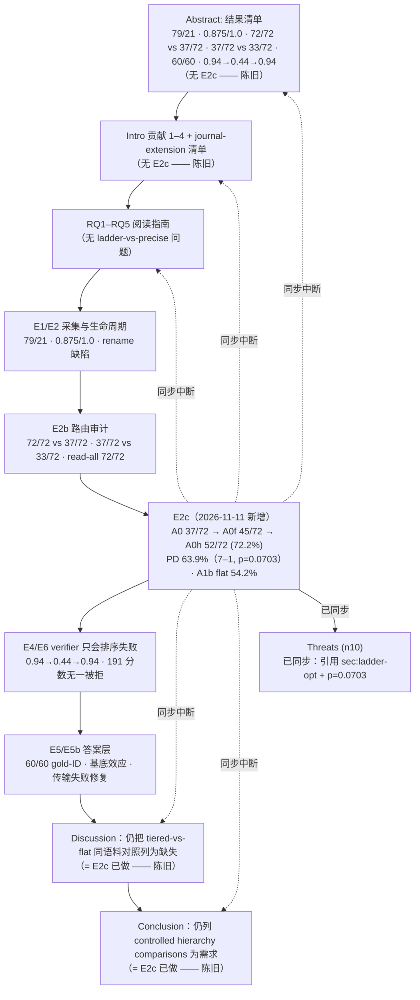

# Committee Reviewer 4 — 逻辑链审查（logic chain audit）

审查对象：HMRS（Knowledge-Based Systems 投稿，20 页 camera-ready 预览，2026-11-11 修订版）。
审查范围：argument logic 与跨章一致性——abstract ↔ intro/contributions ↔ RQ ↔ evaluation ↔ discussion ↔ conclusion 的主张链是否闭合；新增小节 E2c（8.5，2026-11-11）向上游（摘要、贡献）与下游（讨论、结论）的同步状态。
引用均逐字核对自 `paper-kbs/tex/journal_20p/` 下的 LaTeX 源文件。

## Logic Chain Review

### 逻辑分：7 / 10

- **修订前的链条纪律很高（单独看可到 8–9 分）**：摘要、贡献、正文、讨论、结论对所有旧战役的每一个数字都做到了逐点对账（79/21 与 91/12/9 的分解、0.875/1.0、72/72 与 37/72 及 CI/McNemar、37/72 与 33/72 及 p=0.4545、879 parts/24.3 MB/253.7 s/897 calls、60/60 cells、0.94→0.44→0.94 与 p=0.008、191 个分数且最低 0.589、17 个 in-pool golds、41% 超时=111/270）。限定语体系（"not an isolated treatment effect"、"incomplete failure attribution"、"traceability, not entailment"）在各章之间一致复现，几乎没有发现旧内容之间的实质矛盾。
- **2026-11-11 的修订把分数拉到 7**：新增的 8.5 节（E2c "Content-layer optimisation and the ladder-versus-precise contrast"）只在 8.4 节（E2b 的前向引用）与第 10 章 Threats 中被引用；摘要、引言贡献、RQ 清单、Section 8 开篇路线图散文、讨论、结论**六处**均停留在修订前状态；E2c 还引入了一个文中无数据支撑的成本比例（~1/10 search calls），并把"管理主张所依赖的对照"孤立在自己小节内部。另有两处局部概念漂移（E5b 的 A/B/C 标签、19 vs 20 libraries）与一处损坏的交叉引用（`Section~ef{...}`）。

### Logic Chain Diagnostic

### 链条总体评估

1. **主张-证据绑定（修订前内容）：闭合。** 摘要的每个定量陈述都能在正文找到同一数字与同一限定语；贡献 2/3/4 与 E1/E2b/E5/E4-E6 一一对应；讨论与结论的"bounded contribution"措辞与摘要的"These results show selected implemented management paths and failure boundaries, not general retrieval superiority..."完全同调。未发现旧内容之间的数值矛盾。
2. **修订同步（本次审查重点）：系统性断裂。** E2c 自称 "The head-to-head contrast is the one the management claim rests on"（8.5 节），但对 "A0h / PD / A0f / A1b / ladder" 的字符串检索在 main_20p.tex（摘要）、n1_intro.tex、n9_discussion.tex、n11_conclusion.tex 中**零命中**。同步只到达了 8.4 节（E2b 末尾的前向引用）与 n10_threats.tex（"reported in Section~\ref{sec:ladder-opt}; the ladder-versus-precise contrast (A0h vs PD) is directional ($p=0.0703$)"）。这产生一个直接的内部矛盾：讨论与结论把 E2c 已完成的对照列为"尚缺的后续工作"，而 Threats 章又承认它已报告——同一篇论文三个后章对同一事实给出三种状态。
3. **管理主张的锚点被孤立。** 引言定义贡献为 "the management structure that decides which collection is consulted, not a new ranking function"，E2c 声明支撑它的对照是 A0h vs PD；但该对照（72.2% vs 63.9%，p=0.0703，方向性、非显著）在全篇任何主张陈述中都没有被引用。主张与其自称的证据在链的两端同时断开。
4. **E2c 内部算术自洽**（35 misses = 5 truncation + 30 judge/candidate；修复数 8/15/9 精确复现 45/52/46 的观测值），但 "roughly a tenth of the search calls" 这一写入表 5 头条结论的成本比例在全文找不到 A0h 或 PD 的调用计数支撑。

### Breakpoints (quoted)

**B1（stale claim — major）讨论章把 E2c 已完成的对照列为缺失的后续工作**
- Quote + Location（一侧，Section 10 末段，n9_discussion.tex）："Broader claims require independent questions, repeated trials, claim-level support checks, **controlled hierarchy comparisons in which the tiered path is contrasted with a flat baseline over the same corpus**, operator studies and crash-recovery tests."
- 对侧（Section 8.5，n8a_eval.tex）："A follow-up campaign **on the same 72 in-domain questions** therefore varied the content layer ... and added a precise per-document arm that abandons navigation"；"The scoped flat union without a judge (A1b) reached 39/72 (54.2%, p=0.6875)"；"A0h versus PD differs on eight questions (seven A0h-only, one PD-only; exact McNemar p=0.0703)"。
- Why this breaks：讨论章要求做的实验（同语料、tiered vs flat）恰是 8.5 节已经报告的实验；A1b 就是 flat baseline，PD 就是放弃导航的对照臂。第三处（Threats）已同步（"reported in Section~\ref{sec:ladder-opt}"），同一事实在三个后章呈现三种状态（已做/未做/已做但方向性）。
- Minimal fix：改写为"8.5 节的初步对照方向性支持阶梯路径（A0h 72.2% vs PD 63.9%）但未达显著；更广的主张需要显著且跨语料重复的对照"。

**B2（stale claim — moderate）结论章同样把 "controlled hierarchy comparisons" 列为需求**
- Quote + Location（Section 11，n11_conclusion.tex）："Broader evaluation needs independently authored questions, repeated agent trials, claim-level support review, **controlled hierarchy comparisons**, larger multi-collection corpora in which the collection tier can be contrasted against flat and per-collection baselines, and crash-recovery tests."
- 对侧（Section 8.5）："Ladder matches or exceeds precise at ~1/10 the search calls; not significant at 0.05"（表 tab:retrieval-design E2c 行）。
- Why this breaks：结论把"对照本身"说成尚缺；后半句的 "larger multi-collection corpora..." 只覆盖规模需求，不覆盖对照已存在这一事实。
- Minimal fix：将该项改为 "replicated, larger-scale versions of the Section 8.5 hierarchy contrast"。

**B3（stale claim — moderate）摘要结果清单整体停留在修订前状态**
- Quote + Location（Abstract，main_20p.tex）："Exact-string containment was **37/72 and 33/72**; a read-all script found them in 72/72 cases after 879 parts (24.3 MB, 253.7 s) without answering."
- 对侧（Section 8.5）："adding a vector chunk-window union to the judge pack (A0h) raised it further to **52/72 (72.2%, p=6.1×10⁻⁵)**"；"The head-to-head contrast is the one the management claim rests on"。
- Why this breaks：摘要逐项列出 route audit、containment、read-all、answer grids、verifier 全部战役，唯独没有新增的 E2c；读者从摘要看到阶梯路径的 containment 停留在 51.4%（A0），而修订后的核心对照（72.2% vs 63.9%）完全不可见。摘要数字本身无假（各数字与正文一致），问题是清单不完整且与"E2c 是管理主张所依赖的对照"的自我定位冲突。
- Minimal fix：在 containment 句后补一句带限定的 E2c 结果（A0h 72.2% vs PD 63.9%，方向性、非显著）。

**B4（stale claim — moderate）引言贡献清单与 journal-extension 列表均未纳入 E2c；RQ 清单亦无此问题**
- Quote + Location（Section 1，n1_intro.tex）："The journal extension adds acquisition and lifecycle measurements, a paired collection-selection audit, the operational-knowledge case study, **and the verifier-placement and transport-failure analyses**."
- 对侧（Section 8.5）："The head-to-head contrast is the one the management claim rests on"；引言自己的贡献定义："The contribution claimed here is the management structure that decides which collection is consulted"。
- Why this breaks：四条 Contributions 分别绑定 route audit、lower tiers、answer grids、segment-tier 诊断，没有一条对应 E2c；期刊扩展清单同样缺失；RQ1–RQ5 中没有任何一条问"阶梯导航是否优于放弃导航"。论文自称管理主张所依赖的对照在贡献声明中缺位，主张-证据绑定在上游断裂。
- Minimal fix：在贡献 2 或 3 中增加 E2c 的一句话概括（含非显著限定），并在 RQ2 或 RQ3 中补入该问题。

**B5（stale claim — minor）Section 8 开篇路线图漏列 sec:ladder-opt，与其自身表 5 矛盾**
- Quote + Location（Section 8 引言段，n8a_eval.tex）："...verifier failure (Section~\ref{sec:e6}), non-functional behaviour (Section~\ref{sec:e7}) and the gate and search-scope ablations (Section~\ref{sec:e8}) are measured."
- 对侧（同段引用的表 tab:retrieval-design）："E2c & Ten-domain 72 q; content-layer arms & Containment; tiered vs flat vs precise & A0h 72.2% vs PD 63.9% (7–1, p=0.0703); A1b 54.2%"。
- Why this breaks：路线图散文枚举了全部子节却漏掉 8.5 节，而同段表格已含 E2c 行；同一节内散文与表格不同步（表 tab:levels 的 Evidence 列同样未把 E2c 计入任何层级）。
- Minimal fix：在路线图中补 "the content-layer optimisation arms (Section~\ref{sec:ladder-opt})"。

**B6（over-inference — moderate）"~1/10 the search calls" 无文中数据支撑**
- Quote + Location（Section 8.5）："Tiered navigation plus the chunk union therefore matches or exceeds abandoning navigation while issuing **roughly a tenth of the search calls**, but the sample is too small to claim a significant advantage."（同句写入表 5："Ladder matches or exceeds precise at ~1/10 the search calls"）
- 对侧（Section 8.4，全文唯一报告调用数处）："...31.4 KB and 16.3 s **across four calls for A0**. A3 averaged 23.5 KB and 7.8 s across 4.1 calls."；A1 为 "897 tool calls per question"。**A0h 与 PD 的每题调用次数全文未报告。**
- Why this breaks：头条结论中的量化成本优势（1/10）没有任何可核验的两侧调用计数；对照恰是论文自称管理主张所依赖的比较。
- Minimal fix：报告 A0h 与 PD 的每题平均调用数（或标注数据在补充材料的具体表号）。

**B7（over-inference — minor）由 p=0.0703 的 7–1 差异以 "therefore" 推出 "matches or exceeds"**
- Quote + Location（Section 8.5）："The head-to-head contrast is the one the management claim rests on: A0h versus PD differs on eight questions (seven A0h-only, one PD-only; exact McNemar p=0.0703), a consistent direction **that does not reach the 0.05 threshold** on this sample."紧接着："Tiered navigation plus the chunk union **therefore** matches or exceeds abandoning navigation..."
- 同节自带限定："but the sample is too small to claim a significant advantage"；表 5 亦标注 "not significant at 0.05"。
- Why this breaks：单句内部先承认非显著、再用 "therefore" 推出比较性结论；限定词使问题降级为 minor，但 "rests on" 的框架把核心主张架在亚显著证据上（与 B8 复合）。
- Minimal fix：把 "therefore matches or exceeds" 改为 "is directionally consistent with matching or exceeding"，或把 "rests on" 弱化为 "is informed by"。

**B8（logical jump / claim-evidence 绑定断裂 — moderate）管理主张的锚点孤立于 8.5 节内部**
- Quote + Location（Section 8.5）："**The head-to-head contrast is the one the management claim rests on**"
- 对侧（全篇主张陈述处）：摘要 "These results show selected implemented management paths and failure boundaries, not general retrieval superiority..."；引言 "The contribution claimed here is the management structure that decides which collection is consulted"；讨论 "The evidence supports a bounded management-system and audit contribution..."——三处均未引用 A0h vs PD 对照（字符串检索零命中）。
- Why this breaks：论文声明管理主张依赖该对照，但主张被陈述的每一处都不携带该证据；链条上出现"声明的证据锚点"与"主张发生点"脱节。
- Minimal fix：让摘要/贡献/讨论至少各有一处带限定地引用该对照（与 B1–B4 的修复一并完成）。

**B9（broken cross-link — minor）E4 指向 E2c 的交叉引用在源码中损坏**
- Quote + Location（n8b_eval.tex 第 134–135 行）："the current comparison of the tiered path against flat and precise alternatives is reported in **Section~ef{sec:ladder-opt}**, and **Section~ef{sec:e5}** measures what the verification and answer layers add on top of retrieval."
- 对侧（Section 8.5 标签确实存在）：`\subsection{E2c: Content-layer optimisation and the ladder-versus-precise contrast (2026-11-11)}\label{sec:ladder-opt}`。
- Why this breaks：两处 `\ref` 丢失 `\r`（源码字面为 `~ef{...}`），编译后渲染为乱码文本，E4"旧六方法矩阵已被取代、新对照见 8.5 节"的论证交接在 PDF 中断裂。
- Minimal fix：恢复为 `\ref{sec:ladder-opt}` 与 `\ref{sec:e5}`。

**B10（concept shift — minor）E5b 费用标签 (A)/(B)/(C) 与同小节定义的臂名 S1/S2/S3 不匹配**
- Quote + Location（Section 8.7 E5b）："Mean cost was \$0.182 **(A)**, \$0.300 **(B)** and \$0.219 **(C)**"
- 对侧（同小节前文）："Three deployment arms ... **S1** pinned the target shelf, **S2** left the library unpinned, and **S3** pinned it with a hybrid-retrieval directive."
- Why this breaks：旧稿标签残留；读者无法把三个成本值绑定到具体部署臂（按上下文推测 A=S1、B=S2、C=S3，而 S2 恰是假拒绝臂，成本归属影响"部署成本"结论的解读）。
- Minimal fix：统一为 S1/S2/S3。

**B11（stale claim — minor）arXiv 实例库数 19 与 20 两种表述未加说明**
- Quote + Location（Section 8.1 setup）："the running instance then held **19 libraries**"
- 对侧（Section 8.8 E8）："The unscoped call (kb_id="") searched the **20 live libraries**, including 15 outside the five-library evaluation corpus"
- Why this breaks：相差 1 且无快照时间说明；E8 的 unscoped 检索范围与 BQ 题集所用实例是否同一状态无法确认。
- Minimal fix：为两处标注快照日期或统一计数并说明差异。

**B12（concept shift / 设计表述过强 — minor）"holding routing fixed" 与 PD 弃用导航冲突**
- Quote + Location（Section 8.5）："A follow-up campaign on the same 72 in-domain questions therefore varied the content layer **while holding routing fixed**, and added a precise per-document arm that abandons navigation"
- 对侧（同节）："The precise per-document arm PD, which **searches the ten libraries as a directed union** and judges full windows **without navigation**, reached 46/72 (63.9%, p=0.0039)."
- Why this breaks：标题性对照 A0h vs PD 同时改变内容层与路由层，并非"固定路由"下的单因子隔离；措辞会误导读者以为对照 isolates 内容层（"ladder-versus-precise" 的命名本身是诚实的）。
- Minimal fix：改述为"在保持 A0 路由的系列臂之外，另加一个放弃导航的 precise 臂；A0h vs PD 因此同时涉及两层"。

### 未构成问题的核对项（防止误报）

- 所有修订前数字在 abstract/intro/body/discussion/conclusion 间逐点一致（见"链条总体评估"第 1 条）；E2c 内部算术自洽（35=5+30；修复 8/15/9 复现 45/52/46）；A0 37/72、A3 33/72、p=0.4545、read-all 72/72 在 E2b/E2c/图 3 题注/摘要间一致；threats 章对 E2c 的表述与 8.5 节一致。
- "0.94/0.44" 与 E6 的 "0.9375/0.4375 (7/16)" 为同一数值的取整，非矛盾。

### Anti-sycophancy accounting

- challenges_made = 12；surrenders = 0（无一项在复验后撤回；B7、B12 因原文自带限定降级为 minor，但保留）。
- surrender_rate = 0.00；frame_lock_alert = false。
